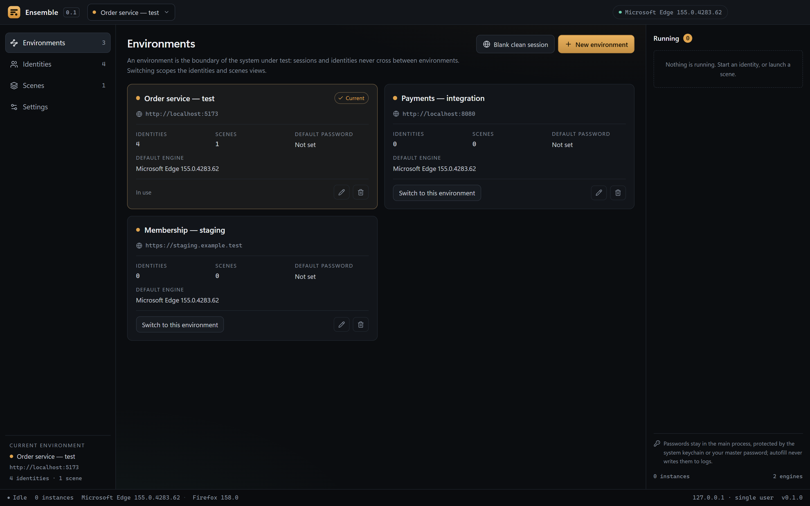
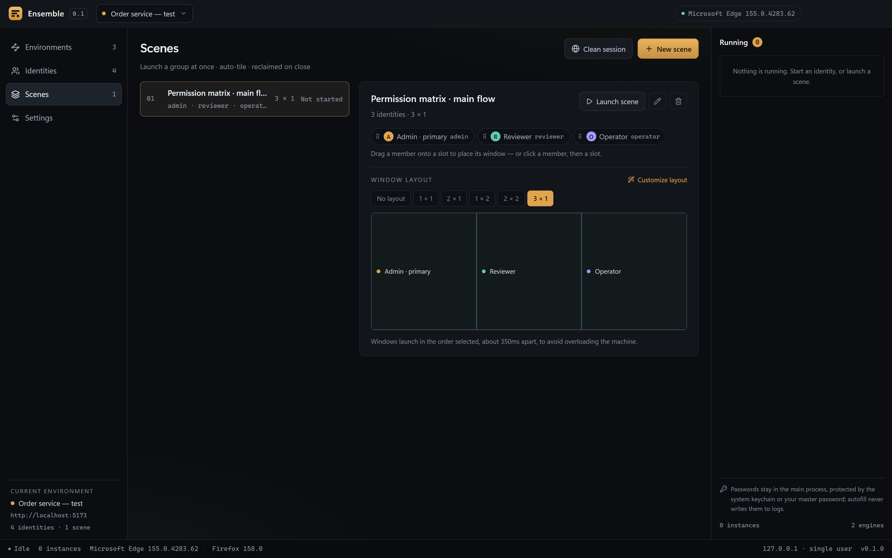

# Ensemble

**Many identities. One stage.** A local multi-account browser workbench for testing permission systems and multi-user collaboration flows.

[中文](README.md) · [Architecture](docs/architecture.md) · [Security](SECURITY.md) · [Contributing](CONTRIBUTING.md)

[](LICENSE)
[](https://github.com/OneFanki/ensemble/actions/workflows/ci.yml)
[](https://www.electronjs.org/)
[](https://vuejs.org/)


## Why

When you test permissions, you keep several accounts open at once — admin, reviewer, regular user — and keep logging out, clearing cookies, and looking passwords up again. Multiple browser windows often leak sessions into each other.

Ensemble turns those windows into a stage you can arrange: every account gets its own browser profile, and you launch a whole group at once, tiled automatically and reclaimed on close. It **does not bundle a browser**. It launches the real Chrome, Edge, Brave or Firefox installed on your machine, so cookies, extensions, downloads and the native password manager behave exactly as they would for a human.

## Concepts

| Concept | Meaning | Isolated |
| --- | --- | --- |
| **Environment** | The target under test: base URL, login path, auth-check path, default credentials | No — it is a scope |
| **Identity** | One account plus one dedicated browser profile | Yes, fully |
| **Scene** | A group of identities and a window layout to launch together | No — it is orchestration |

Environment 1—N identities, environment 1—N scenes, scene N—N identities. Testing one account against two environments means two identities. Switching environments switches both the identities and scenes views — the clearest signal of the isolation boundary — so the rail lists environments as the first entry:

<p align="center">
  
</p>

## Features

- **Fill on launch**: credentials are typed in as soon as the login form appears; the app names any input still unconfigured
- **Fields beyond username and password**: tenant or company codes are matched by label, defined per environment and overridable per identity
- **Real browser isolation**: each identity has its own profile, so sessions, cookies and extensions never mix
- **Scene orchestration**: launch a group of identities, tiled edge to edge with no wasted margin
- **Place windows by role**: drag a member onto a slot to decide who sits where; open windows move with it
- **Custom layouts**: built-in `No layout / 1×1 / 2×1 / 1×2 / 2×2 / 3×1`, plus a drag-and-drop editor for your own saved presets; boxes snap to the stage edges and to each other, with alignment guides
- **No-layout mode**: on a small screen, every window opens full size and overlaps — switch with the taskbar instead of shrinking four windows into tiles too small to use
- **Reopen a single member**: closed one account by mistake? Reopen just that window from the scene detail instead of relaunching the whole scene
- **Credential protection**: OS keychain encryption (DPAPI / Keychain / keyring), optionally hardened with an app master password
- **Clean sessions**: throwaway windows that never log in and are deleted on close; the environments page can also open a blank one that belongs to no environment
- **Process reclamation**: on quit, only browsers launched against Ensemble's own profile root are stopped
- **One entry per job**: the rail navigates environments / identities / scenes / settings; the title bar only switches environments
- **Let an AI do the data entry**: a built-in MCP endpoint receives environments, identities and scenes from your AI client
- **Portable config**: export the whole workspace to JSON, including encrypted passwords
- **Tray mode**: closing the window keeps browsers and the AI endpoint running; only an explicit quit stops them
- **Version check**: Settings → About compares the running version with the latest GitHub release and links straight to the download page; updates are installed by running the newer installer

<p align="center">
  
</p>

The scenes view is a list on the left and a detail pane on the right: select a scene to see its members and layout, adjusting the tiling never launches anything, and only "Run scene" opens the windows. A single window opens centered so it stays comfortable to work in.

<p align="center">
  
</p>

Environment switching lives in a single title-bar menu: it only changes the current scope, while managing and creating environments lives on the environments page.

<p align="center">
  
</p>

The light theme matches the dark one, down to the native title-bar buttons:

<p align="center">
  
</p>

## AI access

Have your AI create the accounts in a container, then record them in Ensemble without typing a single form:

1. Turn on "AI access" in settings to get the loopback URL and a Bearer token;
2. Paste the config snippet into any MCP-capable client (Claude Code, ZCode, …);
3. The AI calls `create_environment`, `create_identities`, `create_scene`, then `launch_scene`.

The server is plain local HTTP + JSON-RPC (a subset of MCP 2025-06-18), bound to `127.0.0.1`.
It validates `Host`/`Origin` against DNS rebinding, and every request needs the Bearer token.
The default port is 47821 and it can be changed.

Permissions are three switches in settings:

| Permission | Tools | Default |
| --- | --- | --- |
| Read | List environments / identities / scenes / layouts, workspace summary | Always on |
| Write | Create and edit environments, identities, scenes, layouts; store passwords | On |
| Run | Launch / stop windows, check sessions | On |
| Delete | Delete environments / identities / scenes | Off |

Hard boundaries:

- **Passwords are write-only.** No tool reads, copies or returns a password; once stored it is only decrypted inside the main process for filling.
- Delete tools additionally require an explicit `confirm: true`. Launch tools are gated only by the Run permission: opening a window changes no data.
- Every call appends one line to `mcp-audit.log`; passwords, passphrases and tokens are replaced with `[redacted]`.
- On quit the MCP server stops before browsers are reclaimed, so the port is released with the process.

<p align="center">
  
</p>

## Import and export

The migration path for a local-first app: settings → Data → export one JSON file with environments,
identities, scenes and layout presets. Browser profiles and sessions are never exported.

- Passwords are excluded by default. With "include passwords", they are sealed with your passphrase
  (scrypt + AES-256-GCM) inside the same file. Importing requires the same passphrase; a wrong one
  rejects the whole file instead of importing half of it.
- Import merges by id: same id overwrites, new entries are appended, and identities or scenes whose
  environment is missing are skipped and counted.
- Running instances and login status are never part of an export.

## Tray mode

On by default: the window's close button only hides it, so browsers and the AI endpoint keep running
while an AI client is mid-task. Quit from the tray menu or the "Quit completely" button in settings;
quitting stops the MCP server first, then reclaims every browser.

## Credential security

Test databases are often copies of production data, so passwords must not sit on disk in plaintext.

- By default, credentials are encrypted with Electron `safeStorage`: Windows DPAPI, macOS Keychain, or the system keyring on Linux
- You can set an **app master password**: a scrypt-derived key (N=32768, r=8, p=1) encrypts each secret with AES-256-GCM, a random IV and an authentication tag; the vault file stores only the salt, KDF parameters and ciphertext
- In master mode the vault starts locked and decrypts only after you unlock it. You can change the password, lock immediately, or switch back to the OS keychain
- Plaintext entries left by older versions are re-encrypted on startup
- Passwords are decrypted only in the main process — never sent to the renderer, never logged. Clipboard copies clear after 30 seconds

An OS keychain stops offline reads but not a program running as your user. A master password closes that gap, which is why this behaves more like a password manager than a config file.

## Engines

| Platform | Full support (CDP) | External mode | Detected, unsupported |
| --- | --- | --- | --- |
| Windows | Edge / Chrome / Brave / Vivaldi / Chromium | Firefox | — |
| macOS | Chrome / Edge / Brave / Vivaldi / Chromium | Firefox | Safari |
| Linux | Chrome / Chromium / Edge / Brave / Vivaldi (incl. Flatpak, Snap) | Firefox | — |

CDP engines support autofill, session checks and window tiling. Firefox runs in external mode: multiple windows, layout and password copy, but no page control. Browsers are installed and updated by the OS; Ensemble never bundles or distributes a browser engine.

## Install

Download the installer for your platform from [Releases](https://github.com/OneFanki/ensemble/releases).

Release artifacts are **not code-signed** (a personal open-source project does not buy certificates).
The system warning on first launch is expected:

- **Windows**: in the SmartScreen dialog choose More info → Run anyway; the browser may need a manual "keep"
- **macOS**: right-click the app → Open, or run
  `xattr -dr com.apple.quarantine /Applications/Ensemble.app`

> This is 0.x software; interfaces and data formats may change.

## Development

Requires Node.js >= 22.12 and pnpm 12.

```bash
pnpm install
pnpm dev        # development mode
pnpm verify     # typecheck + unit tests + structural contracts + build
pnpm test       # unit tests
pnpm test:e2e   # real-browser end-to-end (needs an installed Chromium browser)
pnpm build      # build to out/
pnpm screenshots # regenerate the README screenshots (needs a prior build)
pnpm dist       # package the installer into release/
```

Electron downloads its runtime on first install. If `node_modules/electron/dist` is missing afterwards, rerun the download step:

```bash
node node_modules/electron/install.js
```

## Architecture

```
src/core/       Pure Node: engine discovery, CDP client, launcher, credentials, process registry
src/main/       Electron main process: window, IPC, safeStorage, OS integration
src/preload/    Narrow IPC bridge
src/renderer/   Vue 3 control panel
```

The control panel renders in Electron's own window; pages under test live in real, separate browser processes. `src/core` never imports Electron and can be tested under plain Node.

The primary path talks to browsers over CDP directly rather than hosting human-driven windows through Playwright, which by default takes over dialogs, downloads and extensions and would distort what you are testing. The trade-offs are recorded in the [ADRs](docs/architecture/adr/).

## Non-goals

- No fingerprint spoofing, anti-detection or account farming
- No bundled browser engine
- No test-case management, reporting or CI platform
- No multi-account Safari (it has no per-profile directory model)

## Documentation

| Topic | Location |
| --- | --- |
| Architecture and data model | [docs/architecture.md](docs/architecture.md) |
| Architecture decision records | [docs/architecture/adr/](docs/architecture/adr/) |
| CDP playbook | [docs/engineering/cdp-playbook.md](docs/engineering/cdp-playbook.md) |
| Pitfall library | [docs/engineering/踩坑库.md](docs/engineering/踩坑库.md) |
| Release process | [docs/engineering/release.md](docs/engineering/release.md) |

## Contributing

Issues and pull requests are welcome. Read [CONTRIBUTING.md](CONTRIBUTING.md) first. Report security problems privately as described in [SECURITY.md](SECURITY.md). By participating you agree to the [Code of Conduct](CODE_OF_CONDUCT.md).

## License

[MIT](LICENSE) © 2026 OneFanki
