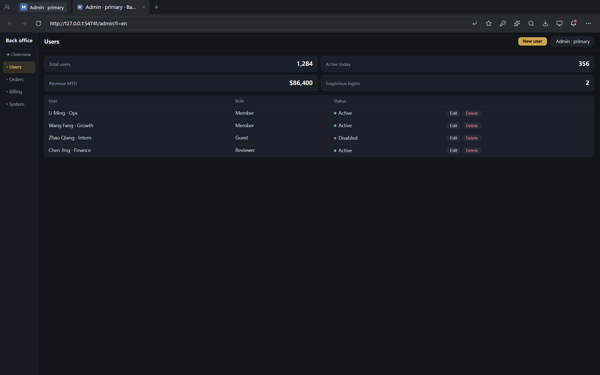
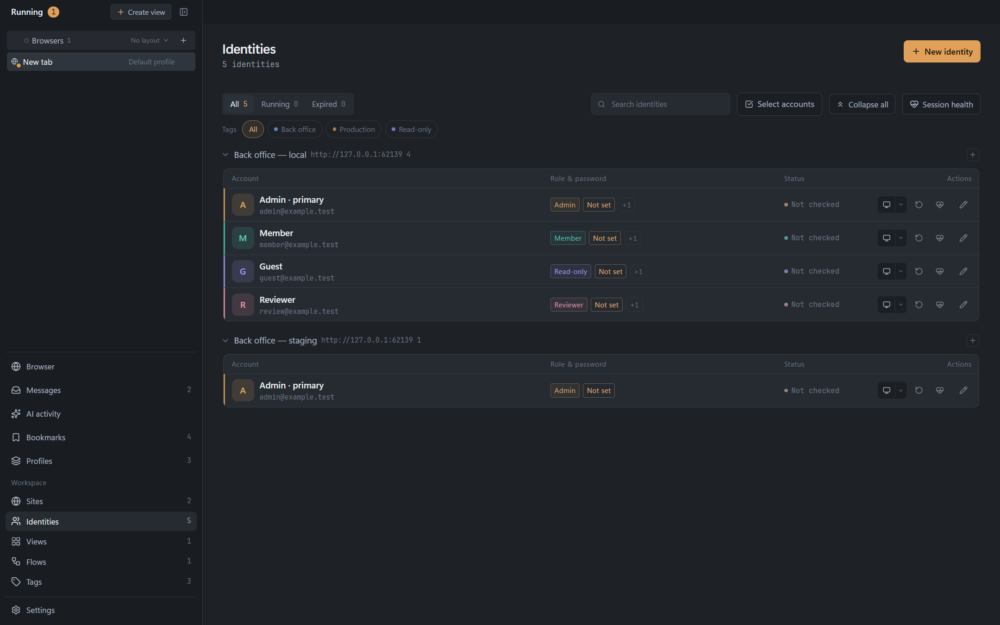
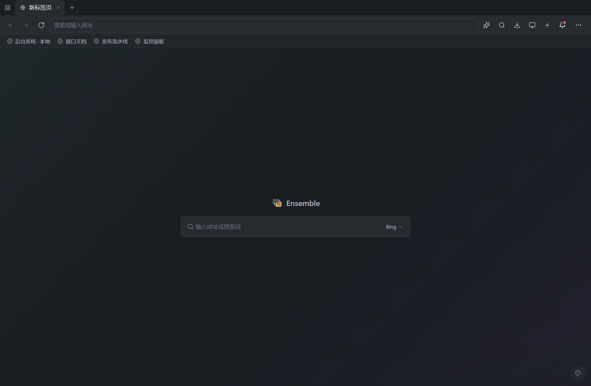
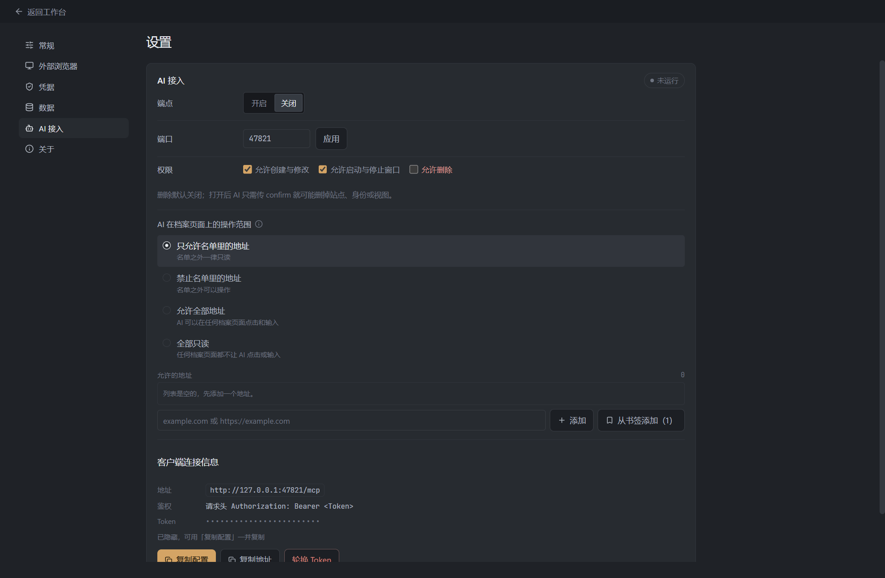

# Ensemble

**A multi-account browser for development and testing.**
Every account of one system, signed in at the same time — stop logging out just to check what another role sees.

The first row of the window *is* the identity bar. Each identity carries its own sign-in data, and
clicking an account lands on its signed-in page. An AI can drive these pages over MCP — read, click,
fill, screenshot — while you watch and take over any time.

[中文](README.md) · [Security](SECURITY.md) · [Contributing](CONTRIBUTING.md)

[](LICENSE)
[](https://github.com/OneFanki/ensemble/actions/workflows/ci.yml)
[](https://www.electronjs.org/)
[](https://vuejs.org/)

<p align="center">
  
</p>

## Why

The same page shows the delete button to the admin and hides it from the member — how do you check?
Sign in as the other account and look. But the things worth checking go past one button: tenant
isolation, flag rollouts, plan boundaries — all of them need several accounts side by side, and every
switch costs a sign-out, a cookie wipe and a retyped password.

Ensemble turns each identity into a separate set of sign-in data: accounts open their signed-in pages
in one click, credentials fill themselves, and several accounts stay online at once without touching
each other. When you need two pictures next to each other, pop a page out to its own window or open
another Ensemble window.

## Three concepts

| | |
| --- | --- |
| **Site** | The address and login recipe of the system under test |
| **Identity** | One set of sign-in data with its own browser profile; the window's first row is the identity bar |
| **Account** | Your user on a site; one click opens its signed-in page |

<p align="center">
  
  
</p>

## Multiple windows

- The app menu, a second launch, or the taskbar icon's right-click all **open another window** —
  sites, accounts, bookmarks and saved passwords come along
- Any page can **pop out to its own window** so two accounts sit side by side; when you switch back,
  the account name floats over the target window, so identical pages still tell you who is who
- **The tray lists every window**; click one to bring it forward. The main window can close to the
  tray and keep the browsers and the AI endpoint running; any other window quits when closed
- The **running strip** in a screen corner (optional) lists every open account window — click to
  switch, minimized windows come back

## AI access

Turn on AI access in settings and paste the config snippet into any MCP client (Claude Code, ZCode,
…). The AI can create sites, record accounts, and drive the embedded browser directly: read pages,
click, fill forms, take screenshots, check sessions. Give it a test-environment URL and a super-admin
login, and it sets up every tenant account for you to review one by one.

An operation that works once can be saved as a flow with `save_flow`; switching tenant names or plans
becomes a single `run_flow`. Flows are listed, edited and run on the settings page.

A few hard edges:

- Passwords are write-only: they go into the OS keychain (optionally behind a master password), and
  no tool reads them back
- Delete tools require an explicit `confirm: true`
- Every call appends an audit line; passwords, passphrases and tokens are redacted
- In the default identity the AI is read-only: clicking and typing need per-site approval, and an
  unapproved site pops an authorization card first
- An address written inside a page cannot steer the AI's navigation — that is the prompt-injection
  defence

<p align="center">
  
</p>

## More capabilities

- **Session health**: check every account's session at once; expired ones get their login page opened
  and filled in one click
- **Batch launch**: tick several accounts and open them all; **login capture** prompts to save after
  a manual sign-in
- **DevTools**: F12 opens the current page's own DevTools, with device emulation and the performance
  monitor
- **Bookmarks**: a folder tree, importable from your local Edge / Chrome / Firefox; the blank page
  doubles as the search field
- **Data**: export and import the whole workspace (passwords optional, encrypted with a passphrase);
  account packs hand a few accounts' sign-ins to someone else
- **Details**: page zoom, tab muting, themes following the system, in-app updates,
  `ENSEMBLE_HEADLESS=1` for windowless runs, and an eight-page guide on first launch

## Engine support

| Platform | Full support (CDP) | External mode | Detected but unsupported |
| --- | --- | --- | --- |
| Windows | Edge / Chrome / Brave / Vivaldi / Chromium | Firefox | — |
| macOS | Chrome / Edge / Brave / Vivaldi / Chromium | Firefox | Safari |
| Linux | Chrome / Chromium / Edge / Brave / Vivaldi (Flatpak, Snap) | Firefox | — |

The embedded browser is the main interface; a real external browser confirms "same for a real user",
with separate sign-in state on each side. Browsers are installed and updated by your system —
Ensemble bundles no browser binaries.

## Install

Grab an installer from [Releases](https://github.com/OneFanki/ensemble/releases), or visit the
showcase page at <https://onefanki.github.io/ensemble/>.

Release builds are **not code-signed** (a personal open-source project does not buy certificates), so
a first-launch warning is expected:

- **Windows**: SmartScreen → More info → Run anyway
- **macOS**: right-click the app → Open, or `xattr -dr com.apple.quarantine /Applications/Ensemble.app`

> This is 0.x software; interfaces and data formats may change.

## Development

Requires Node.js >= 22.12 and pnpm 12.

```bash
pnpm install
pnpm dev         # development mode
pnpm verify      # full check: types + unit tests + structural contracts + build
pnpm e2e:all     # every e2e suite (serial, headless)
pnpm dist        # package installers into release/
```

The first Electron download needs internet access; behind a proxy, export `HTTPS_PROXY` /
`HTTP_PROXY` before `pnpm install`.

## Non-goals

- No fingerprint spoofing, anti-detection, or automated account farming
- Not a Chrome replacement: no extension store, password manager, or cross-device sync
- No test-case management, test reports, or CI platform
- No Safari multi-instance (Safari has no separate profile-directory model)

## License

[MIT](LICENSE) © 2026 OneFanki
