# Ensemble

**Every account of one system, signed in at once.**
Stop logging out just to check what another role sees.

A local multi-account browser workbench: keep several identities of the same system present at the
same time, work in parallel and compare side by side, to confirm that each one sees and can do what
it should.

[中文](README.md) · [Security](SECURITY.md) · [Contributing](CONTRIBUTING.md)

[](LICENSE)
[](https://github.com/OneFanki/ensemble/actions/workflows/ci.yml)
[](https://www.electronjs.org/)
[](https://vuejs.org/)

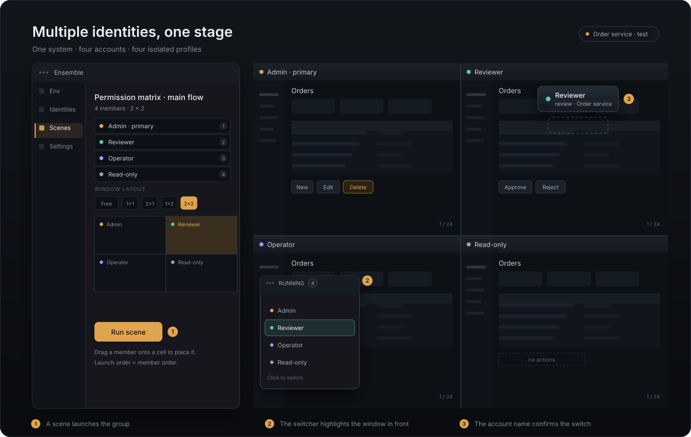

Side by side inside the app, edge to edge in real browsers — every account in its own isolated
browser profile, so switching never leaves you guessing which account you are looking at.

## Why

**On the same page, an admin sees a delete button and a member does not. How do you confirm that?**

Log in as the other account and look — but that is never the whole question. Tenant A's data must
not turn up in tenant B's search, a feature flag must reach only the rollout list, and the free and
paid plans stop at different boundaries. Those differences can only be checked by comparing several
accounts of the same system — and every switch costs you a logout, a cookie wipe and a password
entry, while multiple windows of the same browser leak sessions into each other.

Ensemble turns those windows into a stage you can arrange: every account gets its own browser
profile, and you launch a whole group at once, tiled automatically and reclaimed on close. It has two browser surfaces:

- **Built-in browser (the main surface)**: pages run inside the app window, so nothing pops up as a system window. One screen can show several identities at once (1×1 up to 3×1, or a custom layout), and an AI client can read, click, type and screenshot through MCP while you watch and take over at any moment.
- **External real browser**: when you need to confirm “it behaves the same for a real user”, launch the same group in the Chrome, Edge, Brave or Firefox installed on your machine. Cookies, extensions, downloads and the native password manager behave exactly as they would for a human.

Both surfaces share the same sites, accounts, credentials and views. Switching surfaces means signing in again — each keeps its own sessions.

## Typical scenarios

Permissions are only the easiest example. Any case with one system, several identities and a difference to confirm fits:

| Scenario | The question it answers |
| --- | --- |
| **Roles and permissions** | Is the delete button really admin-only? Is a regular member actually blocked? |
| **Tenants and data isolation** | Can tenant A's account see tenant B's data — in search, in exports, on detail pages? |
| **Feature flags and rollouts** | Is the feature on for the rollout list and genuinely off for everyone else? |
| **Plan and tier differences** | Do the free and paid boundaries match the pricing page, and change on upgrade? |
| **Multi-account collaboration** | After A submits, does B receive it; after approval, does C see the right state? |

What these have in common: **they can only be verified with the identities present at the same time**. Logging out and back in is slow and hides anything that only appears once you switch.

## The AI works; you keep working

Letting an AI drive a browser usually means it either takes over a window or spawns a pile of them.
In Ensemble neither has to happen.

**Pages live in the app's own window, so there is no separate window to pop up.** What the AI opens is
a region of the main interface — visible the whole time, ready for you to take over. No browser process
is started and nothing lands in the taskbar.

**Switching away does not interrupt it.** Change tabs, visit the accounts page, edit settings, or
minimise to the tray: the page the AI is driving keeps working — scripts, clicks, typing and DOM reads
all continue. It works the other way too: the AI's actions never raise your window in front of you.

**Tests do not pop up either.** The 20 end-to-end suites shipped with the app move the window off every
display and run there, leaving the desktop quiet. Your own automation can do the same (see "AI access"):

```bash
ENSEMBLE_HEADLESS=1
```

Only when you need "it behaves the same in a real person's environment" do you switch to an external
real browser — a separate path, triggered explicitly.

## Concepts

| Concept | Meaning | Isolated |
| --- | --- | --- |
| **Site** | A login recipe and an owner: base URL, login path, auth-check path, default credentials; groupable with tags | No — it no longer scopes the UI |
| **Identity** | One login plus one dedicated browser profile; may reference an identity on another site | Yes, fully |
| **View** | One shared screen region: which accounts appear together, in which layout; may span sites | No — it is orchestration |

Site 1—N identities, site 1—N views. A view is optional: without one the surface behaves like a plain browser, and views are created explicitly from the running dock. Isolation is unchanged — one profile per identity, sessions never cross sites — but the site is no longer a global filter: the identities page groups every account by site, and a view may span several. One tag namespace is shared by sites, accounts and views, and an account also matches its site's tags.

<p align="center">
  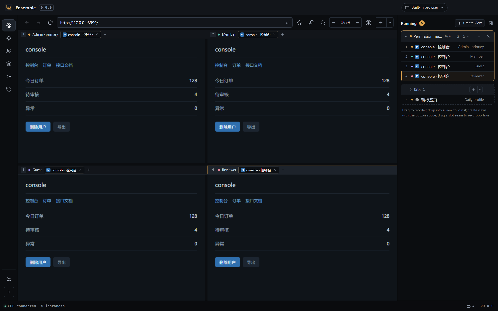
</p>

**The browser is the default page.** The address bar and slot headers sit on top, live pages below, and the running dock on the right lists which accounts are open and in which slot — on every page, always. The left rail collapses to an icon strip by default and expands when the pointer reaches the left edge.

With no view open, startup lands on one blank page whose surface is a search box: type an address or words and press enter. The stage still carries a page strip along the top, just like a cell of a view. Collapsed, the dock keeps one site icon per running instance and hands the width back to the page:

<p align="center">
  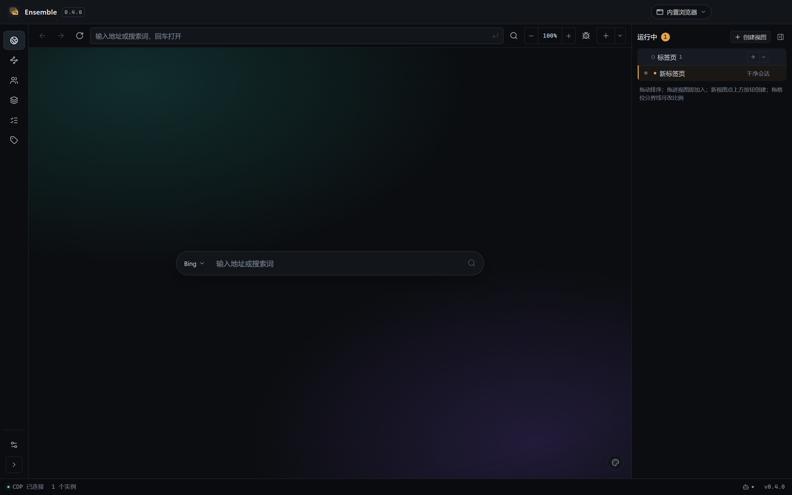
  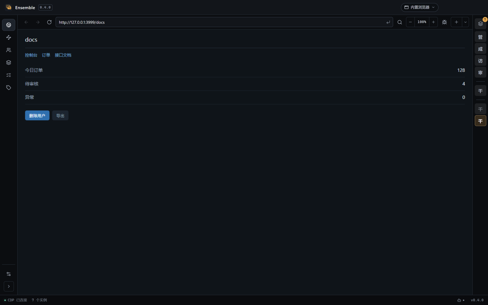
</p>

<p align="center">
  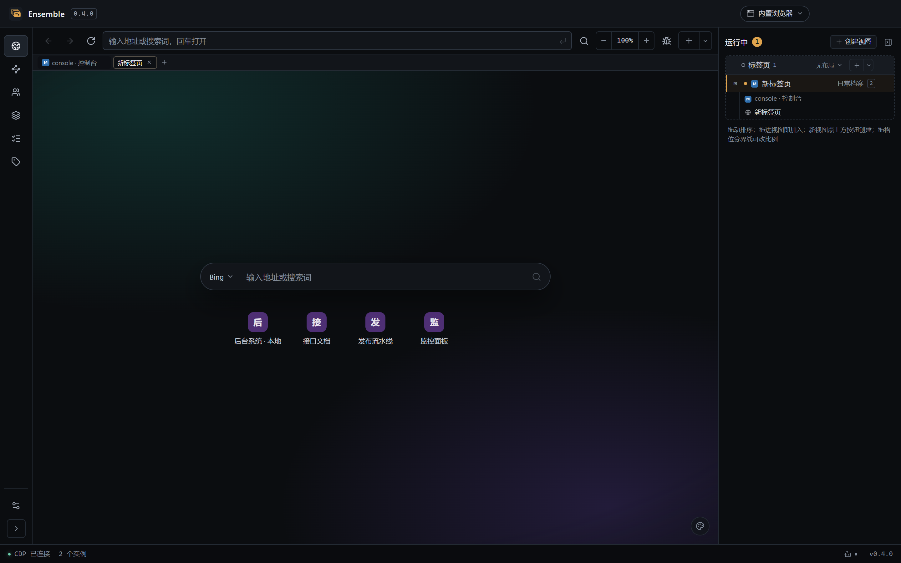
</p>

The identities page is where most of the day is spent: one card per identity with its role, login, session status and running state. Clicking a card opens a page in the default tab group of the built-in surface — it never rearranges the view that happens to be on stage. To put a page into a view, drag the tab there or use the view's own “+”. Launching a batch is the one exception: it opens its own view in the default layout, because a batch is about seeing several at once.

<p align="center">
  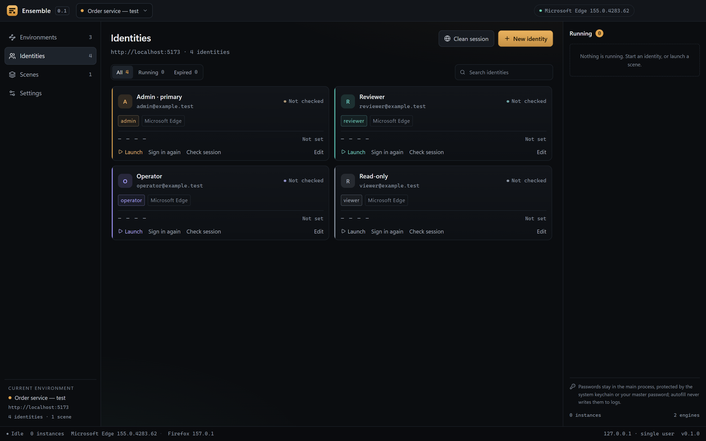
</p>

## Features

- **Running-instances overlay**: a small always-on-top strip on the desktop lists every running identity, grouped by site. One click raises that browser window, restoring it if minimized — no relaunch, no reload. The row of the window that actually owns the OS foreground is highlighted live, so taskbar and Alt+Tab switches follow too. When you do not need it, it collapses into a small square showing only the window count, and snaps to the screen edge after a drag
- **One-click cleanup**: close every instance at once from the bottom of the overlay, the running dock, or the tray menu; stopping a view closes only the tabs it launched, never hand-made or AI-added pages
- **Batch launch**: click “select accounts” on the identities page, tick several, and open them at once in the default layout instead of clicking one by one while every new window covers the next card; the same selection can also be saved as a named view with its own layout
- **Foldable groups**: sites by tag, accounts by site and flows by site each fold as a whole, and the page header has one switch that folds or opens all of them; the folded state is remembered per page across restarts
- **Switch receipt**: after switching from the overlay, the account name floats briefly (~2 s) over the window that was raised, so the right account is obvious even when every page looks the same. The pill is click-through, never takes focus, and injects nothing into the page
- **Fill on launch**: credentials are typed in as soon as the login form appears; the app names any input still unconfigured
- **Per-page zoom**: Ctrl plus/minus zooms the page you are on and Ctrl + 0 returns it to the default; Settings carries the global default, which never overwrites a page you adjusted by hand. Each page keeps its own factor, so one cell can be enlarged for a dense table while the next stays at 100%
- **Developer tools**: docked into the page's own cell by default (a 2×2 grid still shows four pages with their tools), with one click to detach them into a separate window; the toolbar button tracks the open state
- **Fields beyond username and password**: tenant or company codes are matched by label, defined per site and overridable per identity
- **Built-in browser**: pages live inside the app window, so nothing pops up; several identities share one screen, and an AI client can read, click, type and screenshot while you watch and take over
- **A view is one shared screen region**: create one from the running dock, then drag tabs into it (the drop point decides side by side or stacked), switch layouts, drag the seams to re-proportion slots; only one view is on stage at a time and the rest keep running off screen
- **One slot = one browser instance**: a page opened from a page (`target="_blank"`, an OAuth popup) stays inside the same instance and just becomes the page that slot shows — it never takes an extra slot. Switching those pages does not require the dock: the slot header carries a tab strip for the instance in that cell, and one click decides which of its pages the cell shows. The dock lists one row per instance, with that instance's other pages indented beneath it
- **The default tab group has the same strip as a view**: without any view, the stage still carries a page strip at the top — tabs, icons, close, right-click menu and “+”. To see several side by side, pick a layout from the “tabs” block of the running dock and every loose instance is grouped into a new view laid out that way
- **On stage / off stage / selected**: a view shows only as many instances as it has slots; one click on an off-stage instance swaps it into the selected slot, and clicking again swaps back. A dock row can also be dragged straight onto a slot to replace it. Slot numbers make “which pages are on screen right now” a readable fact; an empty slot is a dashed cell with an “add a page here” button that drops a fresh tab straight into that cell
- **One switch for built-in vs external**: pick the launch target at the top right of the title bar once, and launching from the identities page, batch launch, re-login and the views page all follow it. The same menu offers “open a clean session”, which opens in whichever surface that switch names. The dock's “add tab” always opens a built-in tab; the overlay always lists external windows only
- **A site is a login recipe; a bookmark is an address**: the split new-tab button next to the address bar, the dock's ＋ and typing a site name all open a site — daily (reusing whatever login the daily profile already has), clean, or as one of its accounts with that account's session already loaded. An address that needs no login and no site is a bookmark
- **Daily profile**: identity-less pages — new tabs, bookmarks, addresses typed into the bar — share one persistent personal profile, so signing in once keeps working across restarts. That is what lets an assistant act on a page you are already signed in to
- **Save a hand-typed login**: sign in yourself in the built-in browser and the app offers to save it, like the browser's own password bubble; accepting opens the account form pre-filled, and the password only ever passes through the main process into the vault
- **A site is just “where and how to log in”**: there is no global “current site”; accounts are grouped by site, a view may span sites, and one tag namespace is shared by sites, accounts and views. Tag management lives in Settings → Tags, where each tag shows how many sites, accounts and views use it; the tag filter strip is a single scrolling row, so a dozen tags never push the cards down.
- **Running dock**: views, loose tabs and external instances in one place; views are blocks, instances are rows, collapsible as a whole; one click brings the page or window to the front. Collapsed, it keeps one site icon per running instance with the group boundaries still visible — click an icon to switch to it, so the width goes back to the page instead of hiding how many windows are running. Expanding and collapsing are the same control in the same place
- **The blank page is the search box**: startup opens one blank page whose landing surface is a single field — an address opens directly, words go to the selected engine (Bing by default, custom engines accepted) — with a row of bookmarks beneath it: double-click to rename, right-click to remove, drag to reorder, and a star in the address bar bookmarks the page you are on. The surface ships with built-in backdrops, switchable from the bottom-right corner and carried with the workspace on export
- **Two browser surfaces**: the built-in one is the main surface, the external real browser is the fidelity check; both share the same accounts, credentials and layouts
- **Identity references**: an identity can reference one on another site — username, password, display name and role stay in sync while sessions and profiles stay independent; detach when they need to differ
- **Address-change detection**: a site remembers the address that last signed in successfully; if it changes, filling the password requires one explicit confirmation
- **Copy a view to another site**: members that already exist there are reused, the rest become reference identities
- **Real browser isolation**: each identity has its own profile, so sessions, cookies and extensions never mix
- **View orchestration**: launch a group of identities, tiled edge to edge with no wasted margin
- **Place windows by role**: drag a member onto a slot to decide who sits where; open windows move with it
- **Custom layouts**: external windows use the built-in `No layout / 1×1 / 2×1 / 1×2 / 2×2 / 3×1`; the built-in browser uses `No layout (= 1×1) / 2×1 / 1×2 / 2×2 / 3×1` and lets you drag the seams between slots. Either way you can draw your own layout and save it as a preset; boxes snap to the stage edges and to each other, with alignment guides
- **No-layout mode**: on a small screen, every window opens full size and overlaps — switch with the taskbar instead of shrinking four windows into tiles too small to use
- **Reopen a single member**: closed one identity by mistake? Reopen just that window from the view detail instead of relaunching the whole group
- **Session health**: one screen shows who is signed in, who expired and who is unconfirmed across every account; check everyone with one click, or open the login page and fill credentials for every expired account. Accounts with no window open are checked in a hidden browser that reads their own profile and closes again
- **Restore last view**: when enabled in Settings, a cold start reopens the last view in its saved layout inside the built-in browser
- **Credential protection**: OS keychain encryption (DPAPI / Keychain / keyring), optionally hardened with an app master password
- **Clean sessions**: in external mode, throwaway windows with their own profile directory, deleted on close. In the built-in surface each clean open gets its own in-memory session — gone when the process exits, and two clean opens never see each other. The entry lives in the title bar's browser menu and follows that switch
- **Daily profile**: in the built-in surface, identity-less pages share one persistent profile, so signing in once lasts. It is a separate world from a clean session, and a bookmark opens using the login it already holds
- **Process reclamation**: on quit, only browsers launched against Ensemble's own profile root are stopped
- **One entry per job**: the rail navigates browser / sites / identities / views / tags / flows / settings; the title bar only switches sites
- **Let an AI do the data entry**: a built-in MCP endpoint receives sites, identities and views from your AI client; it also drives the built-in browser, so given a test URL and a super-admin login it can create the tenant accounts, save them and put them on stage
- **Flows are reusable assets**: an AI (or you) can save a page operation that worked as a flow — a list of parameterised steps that reruns in one call instead of being worked out again. A flow is steps, not a script, so it stays readable, editable and adjustable in the UI
- **Portable config**: export the whole workspace to JSON, including encrypted passwords
- **Share accounts**: select accounts on the identities page and export a bundle with just those
  logins, so they can be imported elsewhere and skip re-registering. Separate from the
  whole-workspace migration export — your views and layouts stay local
- **Tray mode**: closing the window keeps browsers and the AI endpoint running; only an explicit quit stops them
- **Automatic updates**: the app checks for a new version in the background, shows a short summary when one exists, and downloads, verifies and installs it in one click — then restarts itself. No manual GitHub download, and no browser download warning to get past

<p align="center">
  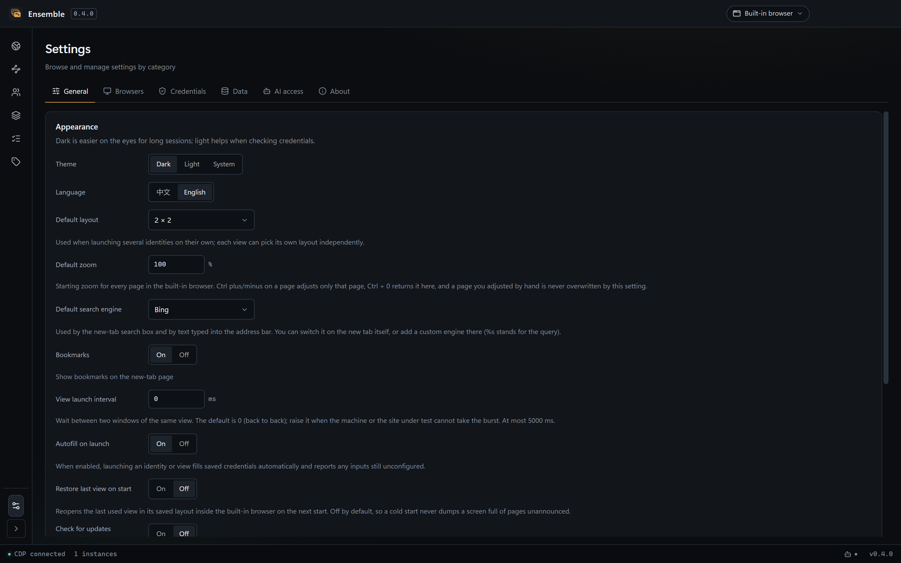
</p>

With a dozen windows open there is no need to hunt through the taskbar: the running-instances overlay stays on top, and one click raises the window for that account.
When it is in the way, collapse it into a small square that shows only the window count, takes almost no room, and snaps to the screen edge after you drag it; click it to expand again. "Close all" at the bottom of the list closes every window at once.

<p align="center">
  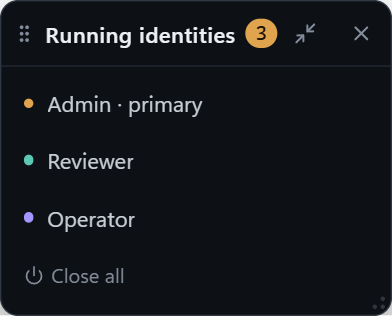
  
</p>

**When every page looks identical, how do you know you switched to the right account?** That is the practical problem with multiple accounts. The overlay highlights the row that actually owns the OS foreground, so raising a window from the taskbar or Alt+Tab moves the highlight too. After a click, the account name briefly floats over the window that was raised and fades after two seconds:

<p align="center">
  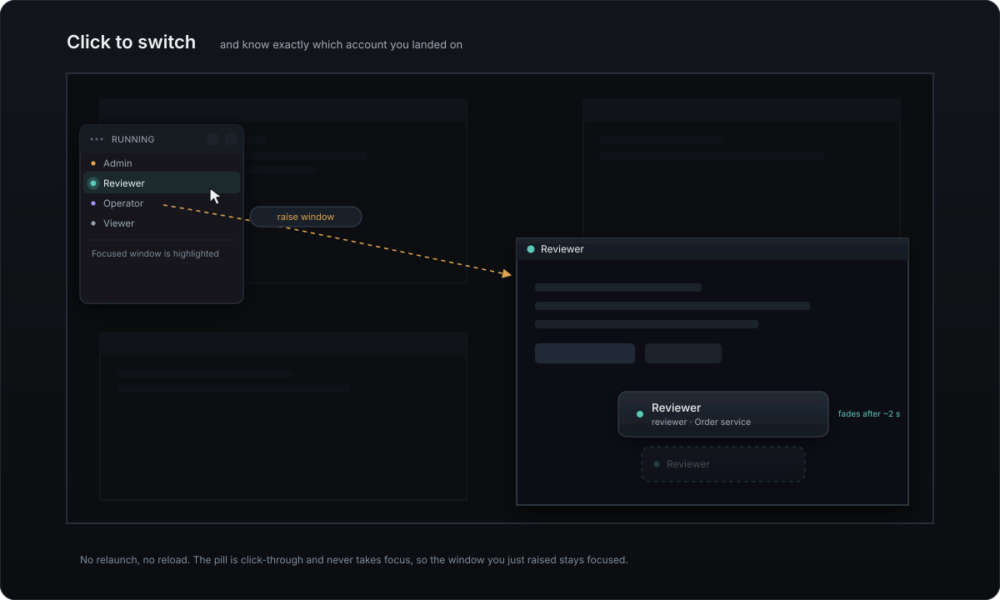
</p>

The pill is click-through, never takes focus, and injects nothing into the page under test, so the system behaves exactly as it does for a real user.

An expired session no longer requires opening each window: the session health panel groups every account into signed in / expired / unconfirmed, checks everyone at once, and can sign every expired identity back in. An identity with no window open is still checkable — a hidden browser reads its own profile, answers, and closes, so no extra windows pile up.

<p align="center">
  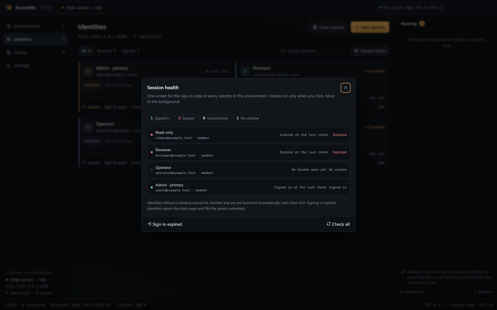
</p>

The views page is a list on the left and a detail pane on the right: select a view to see its members and layout; adjusting the tiling never launches anything. The launch button follows the launch target in the title bar: built-in lays the view out into slots, external opens real browser windows at the same positions.

Tiling really is edge to edge: no gutter between windows, the only line between them is the window frame itself. Each account is marked by the colour dot at the top left, the same dot used in the dock and the overlay:

<p align="center">
  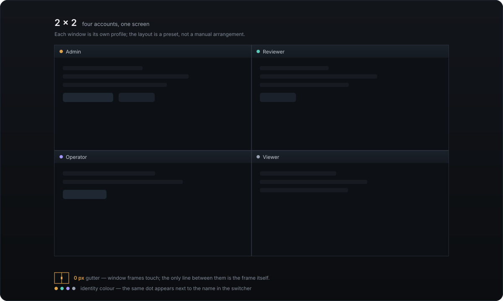
</p>

<p align="center">
  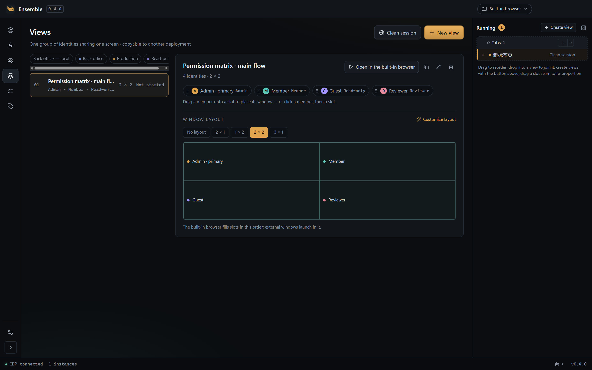
</p>

Site switching lives in a single title-bar menu: it only changes the current scope, while managing and creating sites lives on the sites page.

<p align="center">
  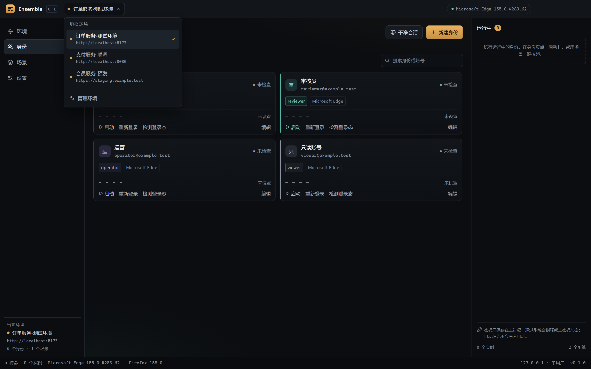
</p>

The light theme matches the dark one, down to the native title-bar buttons:

<p align="center">
  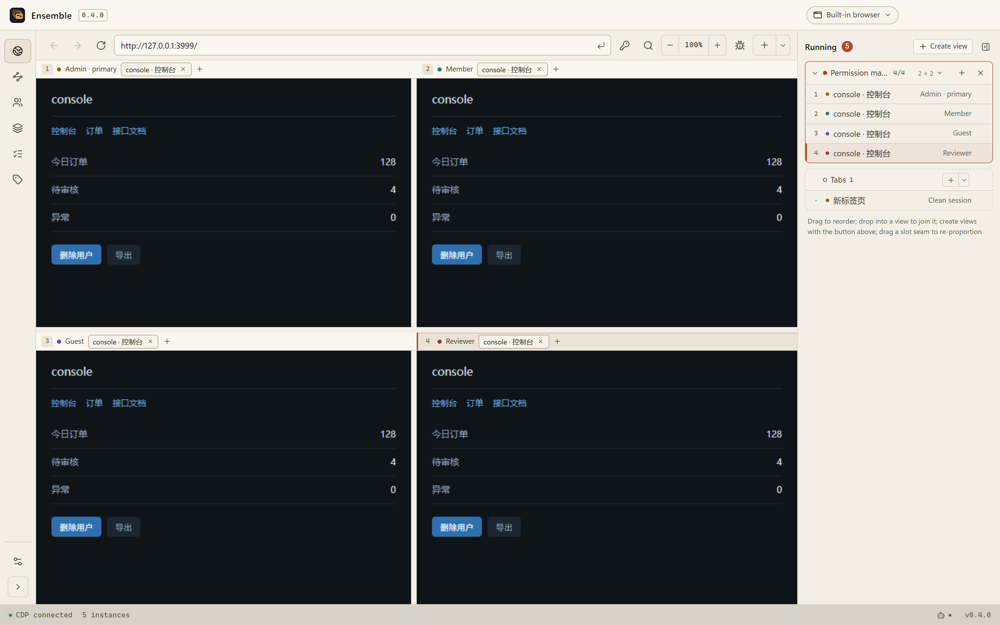
</p>

## AI access

Have your AI create the accounts in a container, then record them in Ensemble without typing a single form:

1. Turn on "AI access" in settings to get the loopback URL and a Bearer token — the AI entry at the right of the status bar jumps straight there, and its dot shows whether the endpoint is running;
2. Paste the config snippet into any MCP-capable client (Claude Code, ZCode, …);
3. The AI calls `create_site`, `create_identities`, `create_view`, then `open_browser_view` (built-in browser) or `launch_view` (external windows).

MCP is not limited to data entry — it can also **drive the built-in browser**. That makes a whole
account-setup flow delegable: hand over a test-environment URL, the super-admin login and a tenant
name, and the AI signs in, clicks through the admin console to create a few tenant accounts in
different categories, then saves each tenant admin as an identity along with its own tenant name.
What you end up with is a stage where each cell is already signed in as the right tenant.

### Example: populate every tenant account of a test environment in one request

```
Set up the test environment at http://localhost:3000 in the built-in browser for me.
Super admin super@example.test / super-secret, tenant name "Default tenant".
Sign in, create three tenants: tenant A (standard), tenant B (pro), tenant C (trial),
each with one admin account, password Tenant-1234. Save all four accounts as identities,
then open them together in a 2×2 view.
```

What the AI does, and with which tool:

| Step | Tool |
| --- | --- |
| Save the site with its tenant field and default password | `create_site` (`extraFields` + `password`) |
| Save the super-admin account | `create_identity` |
| Open the page as the super admin and sign in | `open_browser_tab` → `fill_browser_login` → `click_browser_element` (by button text) |
| Wait for the console to load | `wait_browser` (polling inside the page, one call) |
| Read the tenant form | `read_browser_page` (each input arrives with the label beside it) |
| Fill tenant name, admin login, initial password | `fill_browser_form` (one call; a password never reaches the audit log) |
| Save each identity with its own tenant name | `create_identities` (per-item `extraFields`) |
| Arrange and open them | `create_view` → `open_browser_view` |

Interactive tools address elements the way a person does — `label: "Username"`, `text: "Create
tenant"` — instead of the long `:nth-of-type` paths a snapshot can express, which break the moment
one conditional field appears on a component-library form. Asynchronous renders are waited on with
`wait_browser` (`visible` / `hidden` / `text` / `url` / `value`) rather than sleep-then-read: one
round trip, and no window in which the page changes itself (a menu closing on blur, an option
appearing one frame late).

The pages live in the main window throughout, so you can watch, take over or interrupt at any point.
Signing in as an account that is already saved never asks "save this login?" again — only a
credential the vault does not have yet produces that prompt.

### Example: work it out once, rerun it in one call

Creating a tenant again. The first time, the AI feels its way through the form with
`read_browser_page`; once that works it can keep the path with `save_flow`:

```jsonc
{
  "siteId": "…", "name": "Create tenant",
  "params": [
    { "name": "tenant", "label": "Tenant name", "required": true },
    { "name": "kind", "label": "Plan", "default": "Standard" }
  ],
  "steps": [
    { "action": "navigate", "url": "/admin" },
    { "action": "wait", "condition": "visible", "text": "Create tenant" },
    { "action": "read", "text": "ORD-", "as": "order" },              // capture a value off the page
    { "action": "fill", "label": "Tenant name", "value": "{{tenant}}" },
    { "action": "select", "label": "Plan", "option": "{{kind}}" },
    { "action": "fill", "label": "Note", "value": "Order {{order}}" }, // reuse what step 3 read
    { "action": "click", "text": "Create tenant" },
    { "action": "wait", "condition": "text", "expect": "{{tenant}}" }
  ]
}
```

Changing the name or the plan afterwards is one call:
`run_flow({ id, params: { tenant: "Customer B", kind: "Pro" } })`. The Flows page in the rail lists
these assets grouped by site, expands the steps, runs them from a parameter form (defaults filled in,
secret parameters masked), and lets you edit steps and their order in the UI.

<p align="center">
  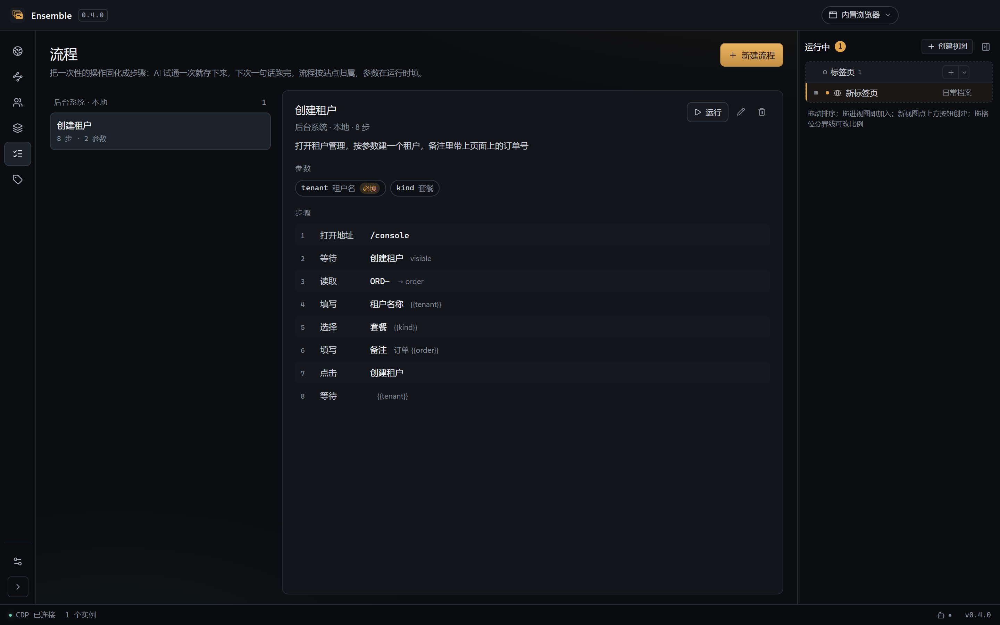
</p>

The editor on the same page changes parameters, adds or removes steps and reorders them; the fields
follow the action, so only what that step actually uses is shown:

<p align="center">
  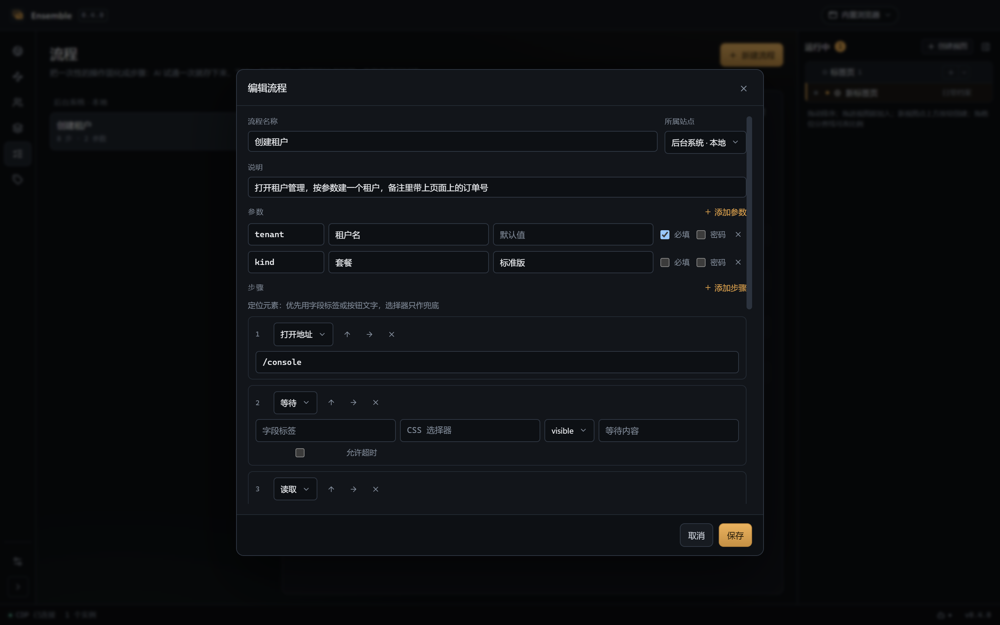
</p>

A flow is deliberately **a list of steps, not a script**. Every step still goes through exactly the
same input path as a human click, so a person can read it, fix it or add one; parameters and
`{{variables}}` are validated when the flow is saved (an undefined variable is refused rather than
failing halfway through a run); and a failing step stops the run and names itself, instead of
leaving half the data written.

The server is plain local HTTP + JSON-RPC (a subset of MCP 2025-06-18), bound to `127.0.0.1`.
It validates `Host`/`Origin` against DNS rebinding, and every request needs the Bearer token.
The default port is 47821 and it can be changed.

Permissions are three switches in settings:

| Permission | Tools | Default |
| --- | --- | --- |
| Read | List sites / identities / views / layouts / flows, workspace summary | Always on |
| Write | Create and edit sites, identities, views, layouts, flows; store passwords | On |
| Run | Launch / stop windows, check sessions, drive the built-in browser, run flows | On |
| Delete | Delete sites / identities / views / flows | Off |

Hard boundaries:

- **Passwords are write-only.** No tool reads, copies or returns a password; once stored it is only decrypted inside the main process for filling.
- Delete tools additionally require an explicit `confirm: true`. Launch tools are gated only by the Run permission: opening a window changes no data.
- Every call appends one line to `mcp-audit.log`; passwords, passphrases and tokens are replaced with `[redacted]`. Text typed into a password field is masked too, even though the parameter is simply called `text`. A call that touches a page also records its **origin**, so "what did the AI do on this site" is answerable from the log alone.
- **The daily profile is read-only for the AI by default.** It is the browser you are signed in to, so an AI may read pages, take screenshots and switch tabs, but clicking, typing, filling a form or running a flow requires you to allow that origin first — from the shield button in the browser toolbar or from Settings. Identity pages and clean sessions are never restricted; those exist to be driven. The dock shows how many AI actions each site has seen this session.
- **Navigation targets must come from you or the workspace.** A blank tab's first navigation, same-site links, and addresses already saved as a site or a bookmark are allowed; an address written in a page's body is not. That is the defence against prompt injection — a tampered page cannot talk the AI into going somewhere else.
- On quit the MCP server stops before browsers are reclaimed, so the port is released with the process.

<p align="center">
  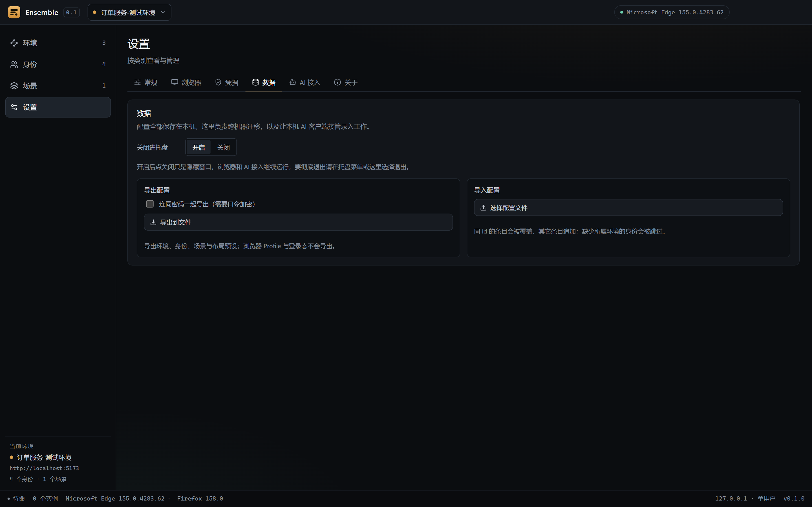
</p>

## Import and export

Two export formats, for two different jobs.

**Config export** (settings → Data) moves a machine: one JSON file with sites, identities, views,
tags, flows and layout presets. Browser profiles and sessions are never exported.

- Passwords are excluded by default. With "include passwords", they are sealed with your passphrase
  (scrypt + AES-256-GCM) inside the same file. Importing requires the same passphrase; a wrong one
  rejects the whole file instead of importing half of it.
- Import merges by id: same id overwrites, new entries are appended, and identities or views whose
  site is missing are skipped and counted.
- Running instances and login status are never part of an export.

**Account bundle** hands logins to another machine or person: click “select accounts” on the
identities page, tick a few (or a whole site) and export just those. The file is much smaller and
contains no views or layouts.

- Matching uses no ids: sites match by URL, accounts by username within the site. A recipient who
  has never seen that site can still import it.
- Passwords are sealed with a passphrase the same way, so copying the file alone does not reveal
  them; a wrong passphrase rejects the whole import.
- Only the chosen sites and accounts travel; everything else stays local.

## Tray mode

On by default: the window's close button only hides it, so browsers and the AI endpoint keep running
while an AI client is mid-task. Quit from the tray menu or the "Quit completely" button in settings;
quitting stops the MCP server first, then reclaims every browser.

## Credential security

Test databases are often copies of production data, so passwords must not sit on disk in plaintext.

- By default, credentials are encrypted with Electron `safeStorage`: Windows DPAPI, macOS Keychain, or the system keyring on Linux
- You can set an **app master password**: a scrypt-derived key (N=32768, r=8, p=1) encrypts each secret with AES-256-GCM, a random IV and an authentication tag; the vault file stores only the salt, KDF parameters and ciphertext
- In master mode the vault starts locked and decrypts only after you unlock it. You can change the password, lock immediately, or switch back to the OS keychain
- Plaintext entries left by older versions are re-encrypted on startup
- Passwords are decrypted only in the main process — never sent to the renderer, never logged. Clipboard copies clear after 30 seconds

An OS keychain stops offline reads but not a program running as your user. A master password closes that gap, which is why this behaves more like a password manager than a config file.

## Engines

| Platform | Full support (CDP) | External mode | Detected, unsupported |
| --- | --- | --- | --- |
| Windows | Edge / Chrome / Brave / Vivaldi / Chromium | Firefox | — |
| macOS | Chrome / Edge / Brave / Vivaldi / Chromium | Firefox | Safari |
| Linux | Chrome / Chromium / Edge / Brave / Vivaldi (incl. Flatpak, Snap) | Firefox | — |

CDP engines support autofill, session checks and window tiling. Firefox runs in external mode: multiple windows, layout and password copy, but no page control. Browsers are installed and updated by the OS; Ensemble never bundles or distributes a browser engine.

## Install

Download the installer for your platform from [Releases](https://github.com/OneFanki/ensemble/releases),
or visit the landing page at <https://onefanki.github.io/ensemble/>.

Release artifacts are **not code-signed** (a personal open-source project does not buy certificates).
The system warning on first launch is expected:

- **Windows**: in the SmartScreen dialog choose More info → Run anyway; the browser may need a manual "keep"
- **macOS**: right-click the app → Open, or run
  `xattr -dr com.apple.quarantine /Applications/Ensemble.app`

> This is 0.x software; interfaces and data formats may change.

## Development

Requires Node.js >= 22.12 and pnpm 12.

```bash
pnpm install
pnpm dev        # development mode
pnpm verify     # typecheck + unit tests + structural contracts + build
pnpm test       # unit tests
pnpm test:e2e   # real-browser end-to-end (needs an installed Chromium browser)
pnpm build      # build to out/
pnpm screenshots # regenerate the README screenshots (needs a prior build)
pnpm diagrams    # regenerate the SVG diagrams (both languages, no build needed)
pnpm dist       # package the installer into release/
```

Electron downloads its runtime on first install. If `node_modules/electron/dist` is missing afterwards, rerun the download step:

```bash
node node_modules/electron/install.js
```

## Architecture

```
src/core/       Pure Node: engine discovery, CDP client, launcher, credentials, process registry
src/main/       Electron main process: window, IPC, safeStorage, OS integration
src/preload/    Narrow IPC bridge
src/renderer/   Vue 3 control panel
```

The control panel renders in Electron's own window; pages under test live in real, separate browser processes. `src/core` never imports Electron and can be tested under plain Node.

The primary path talks to browsers over CDP directly rather than hosting human-driven windows through Playwright, which by default takes over dialogs, downloads and extensions and would distort what you are testing.

## Non-goals

- No fingerprint spoofing, anti-detection or account farming
- No bundled browser engine
- No Chrome replacement: no extension store, no password manager, no sync — and bookmarks stay local (a name and an address, carried with the workspace export) rather than syncing across devices
- No test-case management, reporting or CI platform
- No multi-account Safari (it has no per-profile directory model)

## Contributing

Issues and pull requests are welcome. Read [CONTRIBUTING.md](CONTRIBUTING.md) first. Report security problems privately as described in [SECURITY.md](SECURITY.md). By participating you agree to the [Code of Conduct](CODE_OF_CONDUCT.md).

## License

[MIT](LICENSE) © 2026 OneFanki
