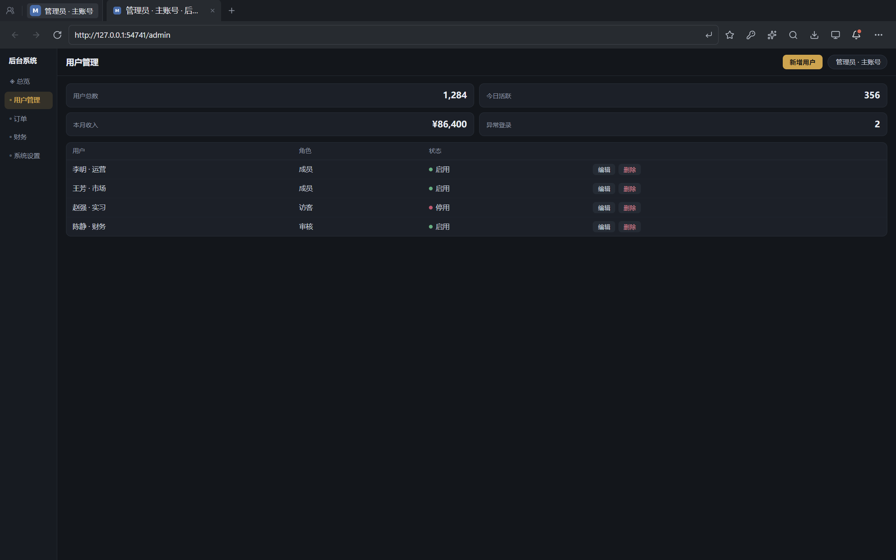
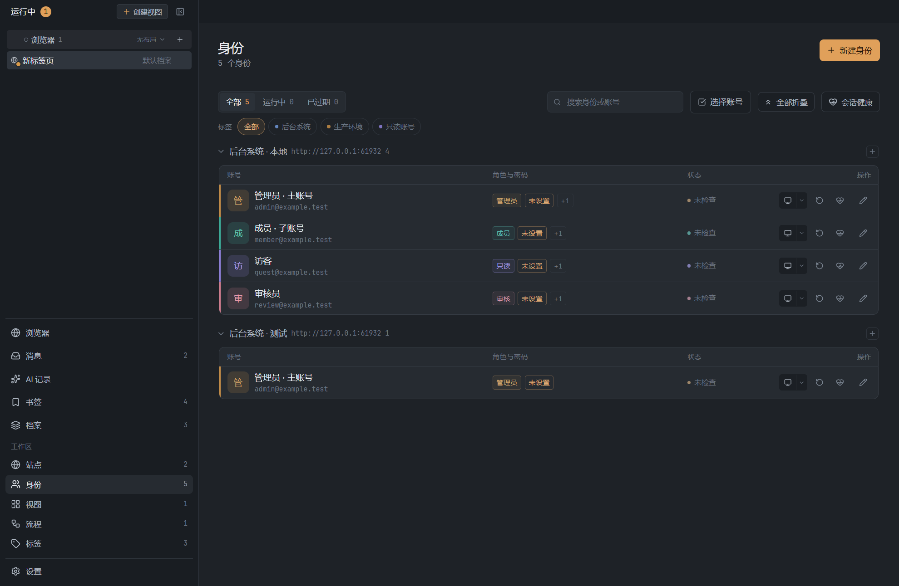
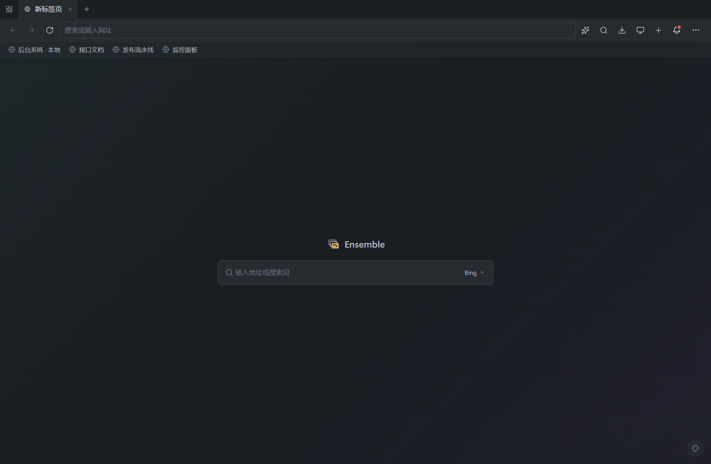
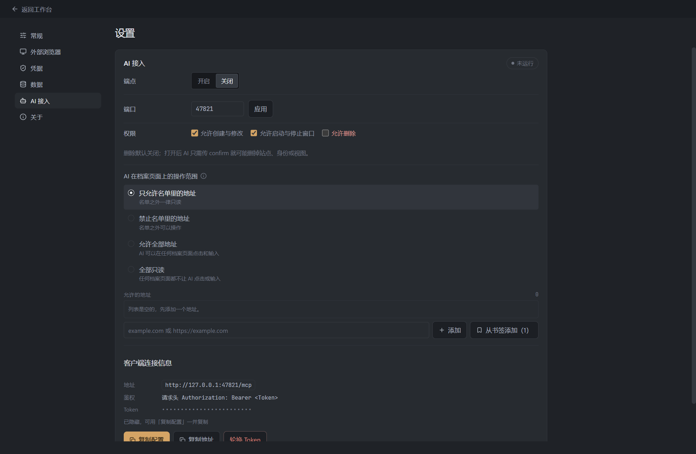

# Ensemble · 同台

**面向开发与测试的多账号浏览器。**
一套系统里的多个账号同时在线——测多角色权限，不用反复退出登录。

窗口第一行就是身份。每个身份一套独立的登录数据，点账号直接进到已登录的页面；
AI 通过 MCP 驱动这些页面，你随时看得见、随时接手。

[English](README.en.md) · [安全策略](SECURITY.md) · [贡献指南](CONTRIBUTING.md)

[](LICENSE)
[](https://github.com/OneFanki/ensemble/actions/workflows/ci.yml)
[](https://www.electronjs.org/)
[](https://vuejs.org/)

<p align="center">
  
</p>

## 为什么

同一个页面，管理员看得到删除按钮，成员看不到——你怎么确认？换个账号登录看一眼就有答案。
但要确认的往往不止一处：租户隔离、灰度开关、套餐边界，都得拿几个账号对照着看。每换一次
账号就退出重登一遍，慢，还容易漏掉切换之后才出现的问题。

Ensemble 把每个身份变成一套独立的登录数据：账号一键进站点，密码自动填好，几个账号同时
在线，互不干扰。需要并排看时，把页面拆出成独立窗口，或者多开几个 Ensemble 窗口。

## 三个概念

| | |
| --- | --- |
| **站点** | 被测系统的地址和登录方式 |
| **身份** | 一套独立的登录数据，有自己的浏览器 Profile；窗口第一行就是身份条 |
| **账号** | 你在某个站点里的一个用户，点一下就开出已登录的页面 |

<p align="center">
  
  
</p>

## 多窗口

- 应用菜单、再次启动、任务栏图标右键都能**新开窗口**：站点、账号、书签和保存的密码都带着走
- 任意页面可**拆出独立窗口**，把两个账号的画面摆在一起对照；切回时目标窗口会浮出账号名，
  页面长得一样也分得清谁是谁
- **托盘列出所有窗口**，点谁把谁提到最前。主窗口可设置关闭进托盘，浏览器和 AI 端点继续
  运行；其余窗口关闭即退出
- 桌面角落的**运行悬浮条**（可关）列出所有开着的账号窗口，点一下切过去，最小化的也能拉回来

## AI 接入

设置里打开「AI 接入」，把配置片段粘进任何支持 MCP 的客户端（Claude Code、ZCode 等）。
AI 能建站点、录账号，也能直接驱动内置浏览器：读页面、点击、填表单、截图、检测登录态。
给它一个测试环境地址和超管账号，它能把几个租户的账号建齐存好，你逐个点开检查就行。

走通的操作可以用 `save_flow` 存成流程，下次换租户名、换套餐就是一次 `run_flow`；
流程在设置页里查看、编辑、直接运行。

几条硬边界：

- 密码只写不读，进系统密钥环加密存储，可再加应用主密码
- 删除类工具要显式传 `confirm: true`
- 每次调用写一行审计日志，密码、口令、Token 一律脱敏
- 默认身份里 AI 只能读：点击、输入要按站点授权，没授权过的会弹卡片问你
- 页面里写的地址指挥不了 AI 导航，防提示注入

<p align="center">
  
</p>

## 其他能力

- **会话健康**：一键检测所有账号的登录态，掉线的一键打开登录页并填好凭据
- **批量启动**：勾几个账号一次全开；**登录捕获**：手动登录后提示保存
- **开发者工具**：F12 打开当前页的 DevTools，含设备模拟与性能监视器
- **书签**：文件夹树，可从本机 Edge / Chrome / Firefox 导入；空白页就是搜索框
- **数据**：配置导出导入（密码可选，口令加密后一起带走）；账号包把几个账号的登录交给别人
- **细节**：页面缩放、标签静音、深浅色跟随系统、应用内自动更新、`ENSEMBLE_HEADLESS=1`
  无窗运行、首次打开有八页使用指南

## 引擎支持

| 平台 | 完整支持（CDP） | 外部模式 | 检测但不支持 |
| --- | --- | --- | --- |
| Windows | Edge / Chrome / Brave / Vivaldi / Chromium | Firefox | — |
| macOS | Chrome / Edge / Brave / Vivaldi / Chromium | Firefox | Safari |
| Linux | Chrome / Chromium / Edge / Brave / Vivaldi（含 Flatpak、Snap） | Firefox | — |

内置浏览器是主界面；外部真实浏览器用来确认「在真人环境里也一样」，两边的登录态各自独立。
浏览器由系统安装和更新，Ensemble 不打包浏览器内核。

## 安装

从 [Releases](https://github.com/OneFanki/ensemble/releases) 下载，或访问展示页
<https://onefanki.github.io/ensemble/>。

发布产物**没有代码签名**（个人开源项目不购买证书），首次运行的告警属于预期：

- **Windows**：SmartScreen 点「更多信息 → 仍要运行」
- **macOS**：右键应用 →「打开」，或 `xattr -dr com.apple.quarantine /Applications/Ensemble.app`

> 当前为 0.x 阶段，接口与数据格式可能变化。

## 开发

要求 Node.js >= 22.12、pnpm 12。

```bash
pnpm install
pnpm dev         # 开发模式
pnpm verify      # 全量校验：类型 + 单测 + 结构契约 + 构建
pnpm e2e:all     # 全部端到端套件（串行，无头运行）
pnpm dist        # 打包安装程序到 release/
```

首次安装 Electron 需要访问外网，国内网络可先配置代理：

```bash
export HTTPS_PROXY=http://127.0.0.1:7890
export HTTP_PROXY=http://127.0.0.1:7890
pnpm install
```

## 非目标

- 不做指纹伪装、反检测或自动化养号
- 不做 Chrome 平替：没有扩展商店、密码管理器与跨设备同步
- 不做用例管理、测试报告或 CI 平台
- 不支持 Safari 多开（Safari 没有独立的 profile 目录模型）

## License

[MIT](LICENSE) © 2026 OneFanki
