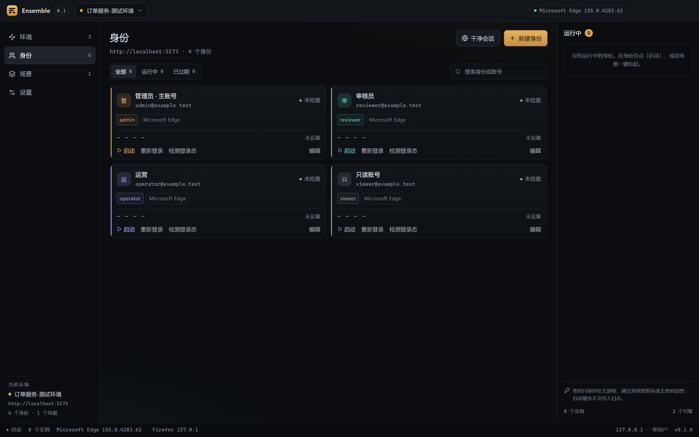
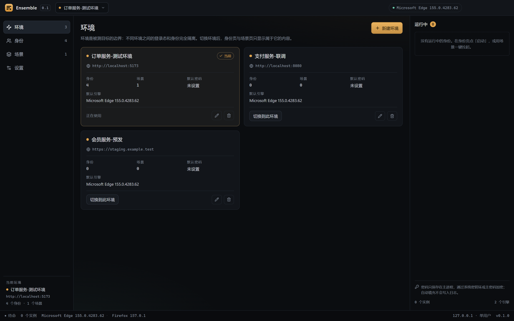
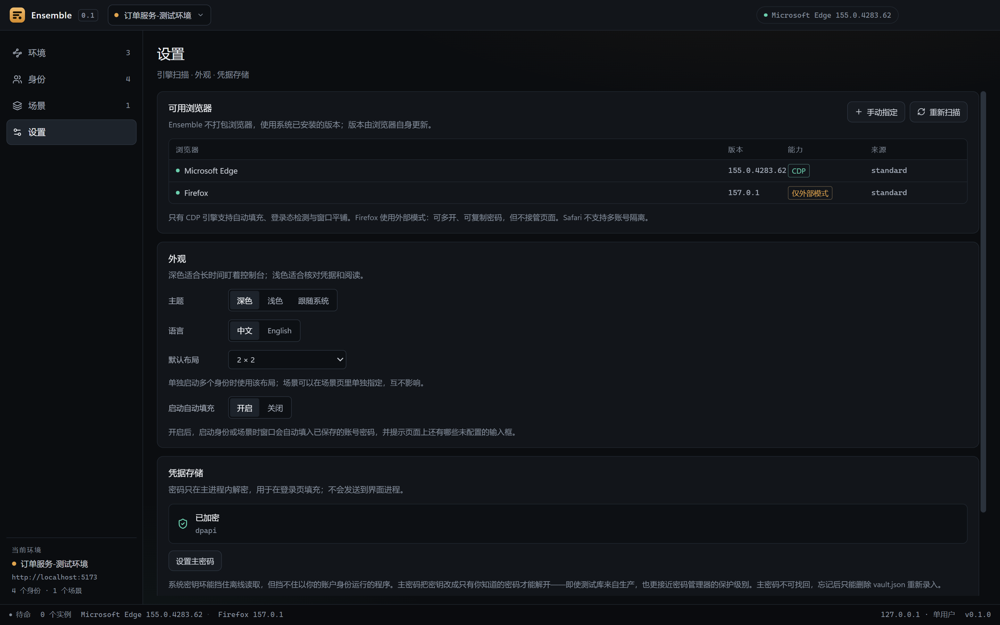
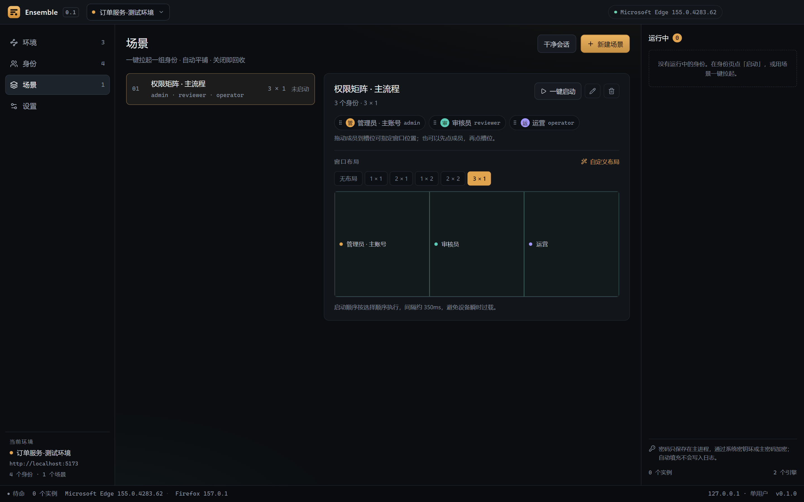
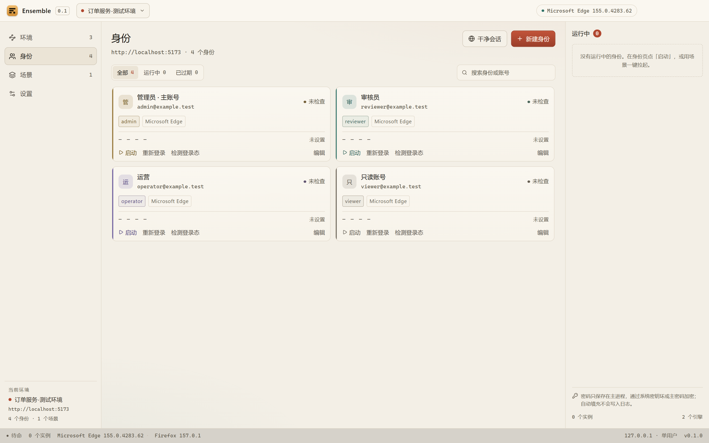

# Ensemble · 同台

**多个身份，同一个舞台。** 一个本地多账号浏览器工作台，用来同时登录多个账号，验证权限系统与多人协作流程。

[English](README.en.md) · [架构](docs/architecture.md) · [安全策略](SECURITY.md) · [贡献指南](CONTRIBUTING.md)

[](LICENSE)
[](https://github.com/OneFanki/ensemble/actions/workflows/ci.yml)
[](https://www.electronjs.org/)
[](https://vuejs.org/)



## 为什么

测权限和协作时，你总得同时开着管理员、审核员、普通用户几个窗口，反复退出登录、清 Cookie、找回密码。
浏览器多开又常常互相串登录态。

Ensemble 把这些窗口变成一张可以编排的台面：每个账号一个完全独立的浏览器 profile，一键拉起一组，
自动平铺，关掉就回收。它**不内置浏览器**，启动的是你系统里真实的 Chrome、Edge、Brave 或 Firefox——
所以你看到的 Cookie、扩展、下载、原生密码管理器行为，和真人操作完全一致。

## 核心概念

| 概念 | 含义 | 是否隔离 |
| --- | --- | --- |
| **环境** | 被测目标：站点地址、登录入口、登录检测地址、默认凭据 | 否，是作用域 |
| **身份** | 一个账号 + 一个独立的浏览器 profile | 是，完全隔离 |
| **场景** | 一次要同时拉起的身份组合与窗口布局 | 否，是编排 |

环境 1—N 身份，环境 1—N 场景，场景 N—N 身份。同一账号要测两个环境时，建两个身份。
切换环境会同时切换身份页与场景页看到的内容——这正是「隔离」在界面上最直观的体现，
所以左侧导航把环境单独列为第一项：

<p align="center">
  
</p>

## 能力

- **启动即填**：窗口打开后自动填入账号密码，并在页面上还有未配置的输入框时点名提示
- **账号密码之外的表单**：租户名、公司码等字段按标签匹配填充，环境级下发、身份级覆盖
- **真实浏览器隔离**：每个身份独立 profile，登录态、Cookie、扩展互不影响
- **场景编排**：一键拉起一组身份，边到边平铺，不留无用外边距
- **按角色摆窗口**：把成员拖到槽位即可指定谁在哪个位置，换位后正在运行的窗口会跟着移动
- **布局可自定义**：内置 `无布局 / 1×1 / 2×1 / 1×2 / 2×2 / 3×1`，也可以拖动方块画自己的布局并保存成预设
- **无布局模式**：小屏幕或需要全屏对照时，每个窗口都以整屏尺寸打开、互相重叠，用任务栏切换，
  不必把屏幕切成四块看不清的小窗
- **成员可单独重开**：误关某个账号的窗口时，在场景详情里点「重新打开」，不必重启整幕
- **凭据保护**：系统密钥环（DPAPI / Keychain / keyring）加密，可再加一层应用主密码
- **干净会话**：不登录、关闭即自动清除的临时窗口
- **进程回收**：退出时按 profile 路径精确回收自己启动的浏览器，不碰你日常用的窗口
- **两条入口各司其职**：左侧导航管环境 / 身份 / 场景 / 设置；顶栏只做环境切换

<p align="center">
  
</p>

场景页是左侧列表加右侧详情：选中一幕后再看成员与布局，调整平铺方式不会误启动；
点「一键启动」才真的拉起窗口。单个窗口居中打开，方便专注操作。

<p align="center">
  
</p>

环境切换收在标题栏的一个下拉里：它只负责切换当前作用域，管理与创建统一在环境页。

<p align="center">
  
</p>

浅色主题与深色主题一致，原生标题栏按钮也随主题切换：

<p align="center">
  
</p>

## 凭据安全

测试库常常是生产数据的副本，所以密码不能明文躺在磁盘上。

- 默认使用 Electron `safeStorage`：Windows DPAPI、macOS Keychain、Linux 系统密钥环
- 可以设置**应用主密码**：用 scrypt（N=32768, r=8, p=1）派生密钥，以 AES-256-GCM
  逐条加密，每条带随机 IV 与认证标签；vault 里只保存 salt、参数和密文
- 主密码模式下，启动后凭据库处于锁定状态，输入主密码才解密；可随时改密、立即锁定或改回系统密钥环
- 旧版本遗留的明文条目会在启动时自动重新加密
- 密码只在主进程内解密，不进入渲染进程、不写入日志；剪贴板复制 30 秒后自动清除

系统密钥环能挡住离线读取文件，但挡不住以你的账户身份运行的程序。主密码把这一层也补上——
这也是为什么它更接近密码管理器而不是「一个配置文件」。

## 引擎支持

| 平台 | 完整支持（CDP） | 外部模式 | 检测但不支持 |
| --- | --- | --- | --- |
| Windows | Edge / Chrome / Brave / Vivaldi / Chromium | Firefox | — |
| macOS | Chrome / Edge / Brave / Vivaldi / Chromium | Firefox | Safari |
| Linux | Chrome / Chromium / Edge / Brave / Vivaldi（含 Flatpak、Snap） | Firefox | — |

CDP 引擎支持自动填充、登录态检测与窗口平铺；Firefox 走外部模式，可多开、可布局、可复制密码，
但不接管页面。浏览器由系统安装和更新，Ensemble 不打包、不分发浏览器内核。

## 安装

从 [Releases](https://github.com/OneFanki/ensemble/releases) 下载对应平台的安装包。

> 当前为 0.x 阶段，接口与数据格式可能变化。

## 开发

要求 Node.js >= 22.12、pnpm 12。

```bash
pnpm install
pnpm dev        # 开发模式
pnpm verify     # 全量校验：类型 + 单测 + 结构契约 + 构建
pnpm test       # 单元测试
pnpm test:e2e   # 真实浏览器端到端（需要本机已安装 Chromium 系浏览器）
pnpm build      # 构建 out/
pnpm screenshots # 重新生成 README 截图（需先 build）
pnpm dist       # 打包安装版与便携版到 release/
```

首次安装 Electron 需要访问外网。国内网络可先配置代理：

```bash
export HTTPS_PROXY=http://127.0.0.1:7890
export HTTP_PROXY=http://127.0.0.1:7890
pnpm install
```

如果 `pnpm install` 后 `node_modules/electron/dist` 不存在，单独重试下载脚本：

```bash
node node_modules/electron/install.js
```

## 技术架构

```
src/core/       纯 Node 层：引擎扫描、CDP 客户端、启动器、凭据、进程注册表
src/main/       Electron 主进程：窗口、IPC、safeStorage、系统集成
src/preload/    受控 IPC 桥
src/renderer/   Vue 3 管理台界面
```

管理台用 Electron 自己的窗口渲染；被测页面由外部真实浏览器进程承载，两者完全独立。
`src/core` 不依赖 Electron，可以在纯 Node 下测试。

主链路直接使用 CDP，而不是用 Playwright 托管人工窗口——Playwright 默认会接管对话框、下载和扩展，
会改变被测环境。设计取舍记录在 [ADR](docs/architecture/adr/)。

## 非目标

- 不做指纹伪装、反检测或自动化养号
- 不内置浏览器内核，不打包 Chromium
- 不做用例管理、测试报告或 CI 平台
- 不支持 Safari 多开（Safari 没有独立的 profile 目录模型）

## 文档

| 内容 | 位置 |
| --- | --- |
| 架构与数据模型 | [docs/architecture.md](docs/architecture.md) |
| 架构决策记录 | [docs/architecture/adr/](docs/architecture/adr/) |
| CDP 操作手册 | [docs/engineering/cdp-playbook.md](docs/engineering/cdp-playbook.md) |
| 踩坑库 | [docs/engineering/踩坑库.md](docs/engineering/踩坑库.md) |
| 发布流程 | [docs/engineering/release.md](docs/engineering/release.md) |

## 贡献

欢迎 issue 和 pull request。提交前请先读 [CONTRIBUTING.md](CONTRIBUTING.md)，
安全问题请按 [SECURITY.md](SECURITY.md) 私下报告。参与本项目即表示同意
[行为准则](CODE_OF_CONDUCT.md)。

## License

[MIT](LICENSE) © 2026 OneFanki
