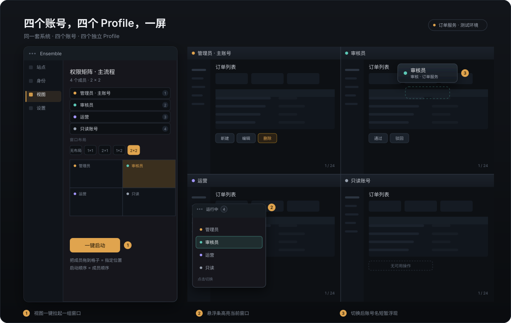
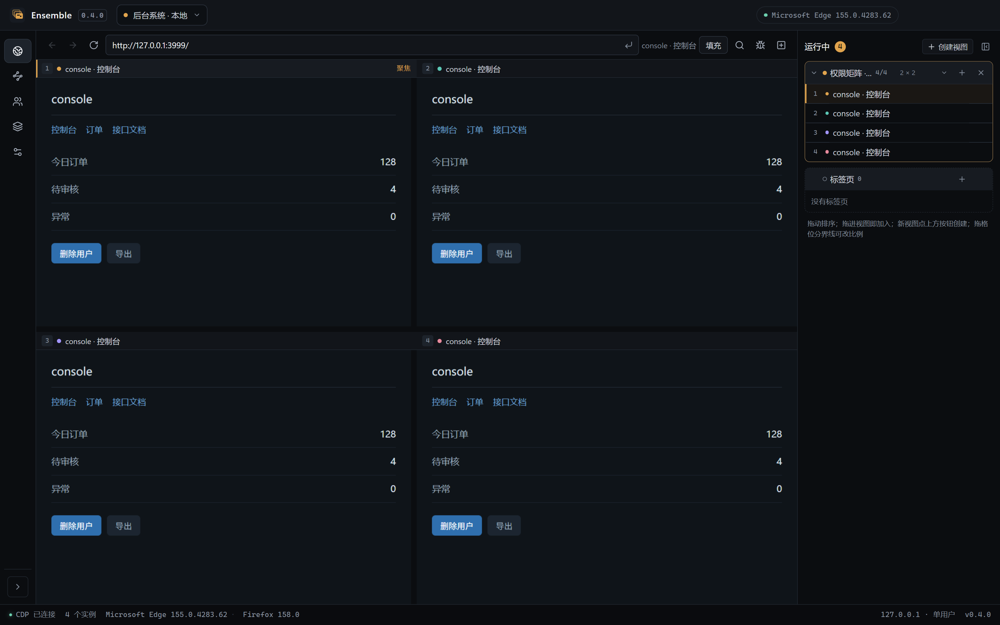
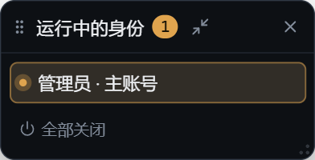
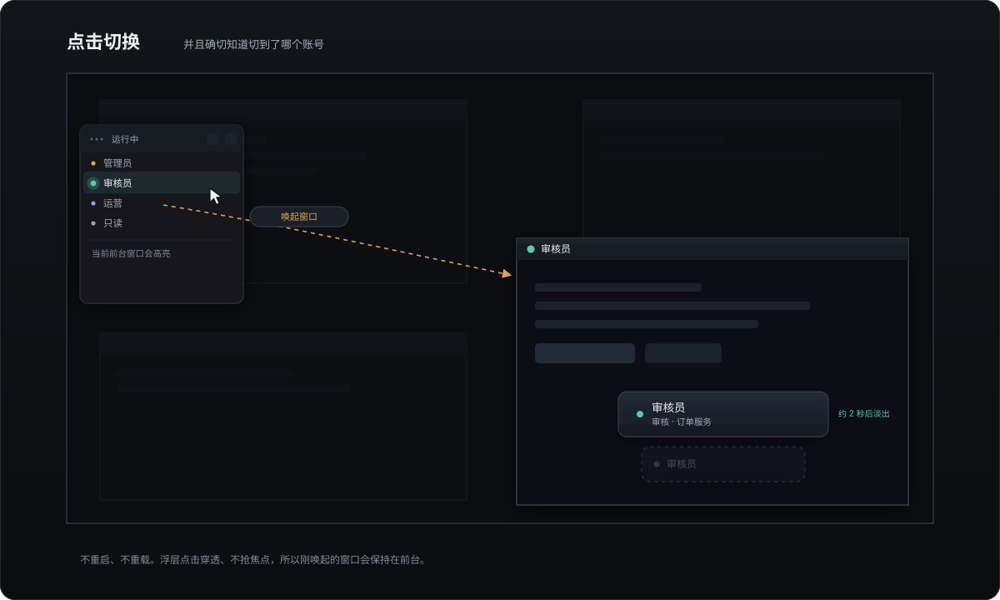
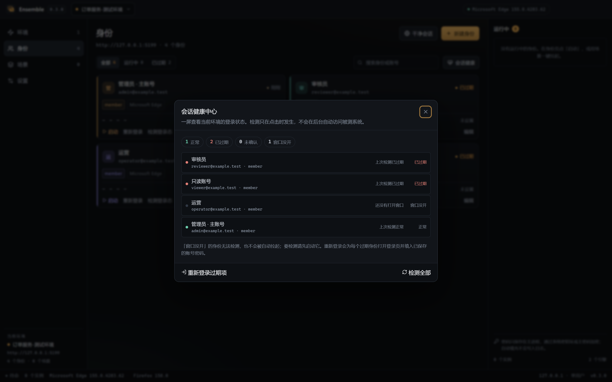
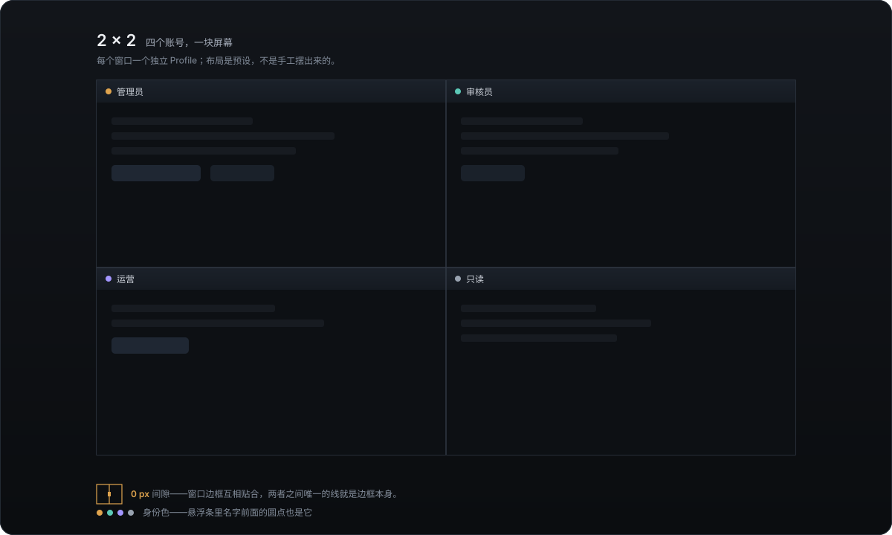
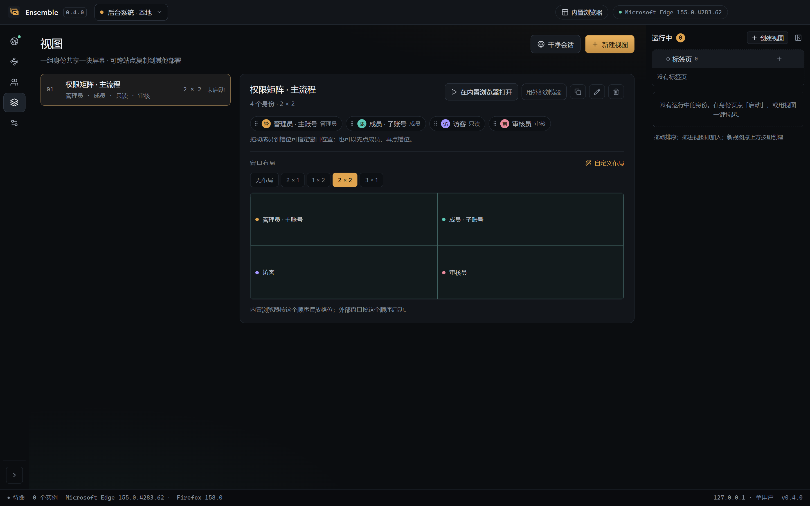

# Ensemble · 同台

**多个身份，同一个舞台。** 一个本地多账号浏览器工作台：同一套系统里让多个身份同时在场，
并行操作、并排对比，验证每个身份看到的内容和能做的操作是否符合预期。

[English](README.en.md) · [架构](docs/architecture.md) · [安全策略](SECURITY.md) · [贡献指南](CONTRIBUTING.md)

[](LICENSE)
[](https://github.com/OneFanki/ensemble/actions/workflows/ci.yml)
[](https://www.electronjs.org/)
[](https://vuejs.org/)



一句话：**一个视图，把一组账号放到同一块屏幕上**——内置浏览器里同屏并排，外部浏览器里边到边平铺，切换时始终知道自己在看谁。

## 为什么

同一套系统里，不同账号看到的东西本来就不一样：管理员多一个删除按钮、租户 A 不该出现租户 B 的数据、
灰度功能只对一部分账号开放、免费版和付费版卡在不同的边界上。要确认这些差异是否正确，
你总得同时开着几个窗口，反复退出登录、清 Cookie、找回密码——浏览器多开又常常互相串登录态。

Ensemble 把这些窗口变成一张可以编排的台面：每个账号一个完全独立的浏览器 Profile，一键拉起一组，
关掉就回收。

它有两个浏览器表面：

- **内置浏览器（主界面）**：页面跑在应用自己的窗口里，不弹系统窗口。一块屏幕可以同时显示几个
  账号（1×1 到 3×1，或自定义布局），AI 通过 MCP 直接在里面读写页面、点击输入、截图，
  人随时能看见并接手。这是日常操作和自动化用的表面。
- **外部真实浏览器**：需要确认「在真人环境里也一样」时，用你系统里的 Chrome、Edge、Brave 或 Firefox
  启动同一组账号。Cookie、扩展、下载、原生密码管理器行为与真实用户完全一致。

两种表面共用同一套站点、账号、凭据与视图模型；切换意味着重新登录一次——内置与外部各自维护独立的登录态。

## 典型场景

权限只是最容易上手的那个例子。凡是「同一套系统、多个身份、需要确认差异」的场合都用得上：

| 场景 | 要回答的问题 |
| --- | --- |
| **角色与权限** | 删除按钮是不是只有管理员能看到？普通成员是不是真的被挡住了？ |
| **多租户与数据隔离** | 租户 A 的账号会不会看到租户 B 的数据？搜索、导出、详情页都查一遍 |
| **功能开关与灰度** | 同一个功能，对灰度名单里的账号是否按预期放开，对名单外是否真的关闭 |
| **套餐与等级差异** | 免费版和付费版的功能边界是否与定价页一致，升级后是否立即生效 |
| **跨账号协作** | A 提交后 B 是否收到待办、审批后 C 看到的状态是否同步正确 |

这些场景的共同点是：**必须同时在场才能验证**。串行地退出再登录，既慢，也容易漏掉「切换之后才出现」的问题。

## 核心概念

| 概念 | 含义 | 是否隔离 |
| --- | --- | --- |
| **站点** | 被测目标：站点地址、登录入口、登录检测地址、默认凭据；可用标签归类 | 否，是作用域 |
| **身份** | 一个登录账号 + 一个独立的浏览器 profile；可引用其他站点的身份 | 是，完全隔离 |
| **视图** | 一块共享屏幕区域：同时显示哪几个账号、用哪个布局 | 否，是编排 |

站点 1—N 身份，站点 1—N 视图。不建视图也能当普通浏览器用；视图从运行栏手动创建，
再把标签拖进去。
切换站点会同时切换身份页与视图页看到的内容——这正是「隔离」在界面上最直观的体现。

<p align="center">
  
</p>

**浏览器是默认页。** 上面是地址栏与格位标题，下面是正在跑的页面；右侧运行栏把「这次开了哪些账号、
各在哪个格位」列成一份可读的清单，跨所有页面常驻。左侧导航默认收起成图标条，鼠标移到左边缘展开。

身份页是日常待得最久的一屏：每个身份一张卡，显示职责、账号、登录态与运行状态，
点正在运行的身份就是切过去，停止是独立按钮。

<p align="center">
  
</p>

## 能力

- **内置浏览器**：页面跑在应用自己的窗口里，不弹系统窗口；一块屏幕同时显示几个身份，
  AI 可以直接读写页面、点击输入、截图，人随时能看见并接手
- **视图 = 一块共享屏幕区域**：用运行栏的「创建视图」按钮建一块区域，再把标签拖进去
  （落点决定左右还是上下），切换布局、拖分隔缝改比例；同一时刻只有一个视图在台上，
  其余继续在窗口外运行
- **一个格位 = 一个浏览器实例**：页面里点开的新标签页属于同一个实例（换一页显示），
  不会多占格位；运行栏一行一个实例，实例自带的页面缩进列在下面
- **台上 / 台下 / 聚焦**：视图里有几个实例就只显示几个，其余仍在运行；点一下台下实例就换进聚焦格位，
  再点一次换回来。格位号把「现在到底哪几个在屏幕上」变成可读的事实
- **右侧运行栏**：内置视图、内置扁平标签与外置实例在同一处；视图是块、标签是行，
  可折叠、可整栏收起，点一下就把对应的页面或窗口提到你面前
- **两种浏览器表面**：内置是主界面，外部真实浏览器是保真校验；两者共用同一套账号、凭据与布局
- **运行实例悬浮条**：桌面上一个始终置顶的小条，列出所有运行中的外部窗口（按站点分组）；
  点一下就把对应的浏览器窗口提到最前，最小化也会恢复，**不重启、不重载页面**；
  并实时高亮当前真正在前台的那个窗口，任务栏或 Alt+Tab 切换也会跟着走。
  用不到时收成一个只显示窗口数量的小方块，不占桌面，拖动后自动贴边
- **批量启动**：身份页进入多选模式，勾几个身份一次按默认布局铺开，不必逐个点击、被新窗口反复遮挡
- **一键收尾**：悬浮条底部、运行栏和托盘菜单都能一次关闭所有实例；视图详情里的停止只关这个视图
  启动的标签，不误伤手动打开或 AI 新增的页面
- **切换回执**：从悬浮条切到外部窗口后，目标窗口上方短暂浮出账号名（约 2 秒），
  页面全都一样时也能确认切到了谁；浮层不挡鼠标、不抢焦点、不注入被测页面
- **启动即填**：窗口打开后自动填入账号密码，并在页面上还有未配置的输入框时点名提示
- **账号密码之外的表单**：租户名、公司码等字段按标签匹配填充，站点级下发、身份级覆盖
- **身份引用**：一个身份可以引用另一个站点的身份，用户名、密码、显示名、角色完全同步，
  登录态与 profile 各自独立；想各改各的就断开引用
- **地址变更检测**：站点记住上次成功登录的地址，地址变了会拦住密码填充并要求一次确认
- **视图跨站点复制**：把这套编排搬到另一个站点，同名身份直接复用、没有的建引用身份
- **真实浏览器隔离**：每个身份独立 profile，登录态、Cookie、扩展互不影响
- **视图编排**：一键拉起一组账号，边到边平铺，不留无用外边距
- **按角色摆窗口**：把成员拖到槽位即可指定谁在哪个位置，换位后正在运行的窗口会跟着移动
- **布局可自定义**：外置模式内置 `无布局 / 1×1 / 2×1 / 1×2 / 2×2 / 3×1`，内置浏览器用
  `无布局（= 1×1）/ 2×1 / 1×2 / 2×2 / 3×1`，格位之间还能拖分隔缝改比例；也可以拖动方块画自己的
  布局并保存成预设，拖动时自动吸附到屏幕边缘与相邻槽位，并显示对齐参考线
- **无布局模式**：小屏幕或需要全屏对照时，每个窗口都以整屏尺寸打开、互相重叠，用任务栏切换，
  不必把屏幕切成四块看不清的小窗
- **成员可单独重开**：误关某个身份的窗口时，在视图详情里点「重新打开」，不必重启整组
- **会话健康中心**：一屏看清当前站点里谁正常、谁掉线、谁还没开窗口；可一键检测全部、
  一键为所有过期身份打开登录页并填好凭据
- **恢复上次视图**：设置里开启后，冷启动在内置浏览器里按原布局恢复上次的视图
- **凭据保护**：系统密钥环（DPAPI / Keychain / keyring）加密，可再加一层应用主密码
- **干净会话**：不登录、关闭即自动清除的临时窗口；站点页还能开一个不属于任何站点的空白干净会话
- **进程回收**：退出时按 profile 路径精确回收自己启动的浏览器，不碰你日常用的窗口
- **两条入口各司其职**：左侧导航管浏览器 / 站点 / 身份 / 视图 / 设置；顶栏只做站点切换
- **AI 直接录入**：内置 MCP 端点，AI 在容器或数据库里建好账号后，直接写入站点、身份与视图，
  也能直接驱动内置浏览器
- **配置导入导出**：整份工作区可导出成 JSON，换机器时连加密密码一起带走
- **关闭进托盘**：关窗不退出，浏览器与 AI 端点继续运行；彻底退出会一并停止
- **应用内自动更新**：启动后在后台检查新版本，有更新时弹窗显示简短摘要，点一下即可下载、
  校验并安装，装完自动重启；不用再去 GitHub 下载安装包，也不容易触发浏览器的下载拦截

<p align="center">
  
</p>

开着十来个窗口时，不必再去任务栏里逐个找：运行实例悬浮条始终置顶，点一下就把对应账号的窗口提到最前。
不需要它的时候点右上角收起，会变成一个只显示窗口数量的小方块——不占桌面，
按住可以拖到任意位置，松手自动贴边；点一下再展开。列表底部的「全部关闭」一次收掉所有窗口。

<p align="center">
  
  
</p>

**页面长得一模一样时，怎么确认切对了人？** 这是多账号场景最实际的麻烦。悬浮条会实时高亮「当前真正在前台」
的那一行——它读的是系统前台窗口，所以你自己用任务栏或 Alt+Tab 切换，高亮也会跟着走。
点下去之后，被切到的窗口上方会短暂浮出一个半透明的账号名，两秒后淡出：

<p align="center">
  
</p>

这个浮层点不穿、不抢焦点，也不往被测页面里注入任何东西，所以被测系统的表现和真人操作完全一致。

登录态掉线不用逐个点开看：会话健康中心把当前环境的身份按「正常 / 已过期 / 未确认」分类，
可以一次检测全部，也可以一次把所有过期身份拉起来重新登录。窗口没开的身份照样能检测——
后台用一个不显示窗口的浏览器读取它自己的 Profile，查完立即关闭，不会多出一堆窗口。

<p align="center">
  
</p>

视图页是左侧列表加右侧详情：选中一个视图后再看成员与布局，调整平铺方式不会误启动。
主按钮「在内置浏览器打开」按布局摆进格位；旁边的「用外部浏览器」走真实窗口，用于保真复核。

多窗口平铺是真正的边到边贴合：窗口之间没有留白，唯一的分隔线就是窗口自己的边框。
每个账号全靠左上角那个色点区分，色点和运行栏、悬浮条里的完全一致：

<p align="center">
  
</p>

<p align="center">
  
</p>

站点切换收在标题栏的一个下拉里：它只负责切换当前作用域，管理与创建统一在站点页。

<p align="center">
  
</p>

浅色主题与深色主题一致，原生标题栏按钮也随主题切换：

<p align="center">
  
</p>

## AI 接入

让 AI 帮你在容器里建账号，然后直接把账号录进 Ensemble——省掉手工一条条填表：

1. 设置页打开「AI 接入」，得到回环地址与 Bearer Token；
2. 把配置片段粘进你的 AI 客户端（Claude Code、ZCode 等支持 MCP 的客户端）；
3. AI 调 `create_site` 建站点、`create_identities` 批量录身份、`create_view` 编排视图，
   `open_browser_view` 直接在内置浏览器里打开，或 `launch_view` 走外部窗口。

服务是纯本地 HTTP + JSON-RPC（MCP 2025-06-18 协议子集），只监听 `127.0.0.1`，
校验 `Host`/`Origin` 防 DNS 重绑定，所有请求都要 Bearer Token。默认 47821 端口，可改。

权限分三档，都在设置页开关：

| 权限 | 覆盖的工具 | 默认 |
| --- | --- | --- |
| 读 | 列出站点 / 身份 / 视图 / 布局、工作区概览 | 始终开放 |
| 写 | 创建与修改站点、身份、视图、布局；写入密码 | 开 |
| 运行 | 启动 / 停止窗口、检测登录态 | 开 |
| 删除 | 删除站点 / 身份 / 视图 | 关 |

几个硬边界：

- **密码只写不读**。没有读密码、复制密码或返回明文的工具；密码进加密凭据库后就只在主进程内用于填充。
- 删除类工具即使开了权限，也必须显式传 `confirm: true`。启动类只受「运行」权限控制：
  打开窗口本身不改任何数据。
- 每次调用写一行审计日志（`mcp-audit.log`），密码、口令、Token 一律替换成 `[redacted]`。
- 应用退出时先关 MCP 再回收浏览器，端口随进程释放，不会留下驻留服务。

<p align="center">
  
</p>

## 导入导出

纯本地应用的迁移路径：设置页 →「数据」→ 导出成一份 JSON，包含站点、身份、视图与布局预设；
浏览器 Profile 与登录态不导出（换机器本来就该重新登录）。

- 密码默认不导出。勾选「连同密码一起导出」后，密码会用你设置的口令经 scrypt + AES-256-GCM
  加密后放进同一个文件；导入时要输入同一口令，口令错误则整体拒绝，不会只导入一半。
- 导入按 id 合并：相同 id 覆盖，新条目追加；所属站点缺失的身份与视图会被跳过并计入结果。
- 导出文件不包含运行中实例与登录状态。

## 托盘模式

默认开启：点窗口的关闭按钮只是隐藏到托盘，浏览器窗口与 AI 接入继续运行——
避免正在用 AI 建视图时误关应用导致连接断开。要从托盘菜单或设置页的「彻底退出」退出，
退出前会先停 MCP、再回收全部浏览器。

## 凭据安全

测试库常常是生产数据的副本，所以密码不能明文躺在磁盘上。

- 默认使用 Electron `safeStorage`：Windows DPAPI、macOS Keychain、Linux 系统密钥环
- 可以设置**应用主密码**：用 scrypt（N=32768, r=8, p=1）派生密钥，以 AES-256-GCM
  逐条加密，每条带随机 IV 与认证标签；vault 里只保存 salt、参数和密文
- 主密码模式下，启动后凭据库处于锁定状态，输入主密码才解密；可随时改密、立即锁定或改回系统密钥环
- 旧版本遗留的明文条目会在启动时自动重新加密
- 密码只在主进程内解密，不进入渲染进程、不写入日志；剪贴板复制 30 秒后自动清除

系统密钥环能挡住离线读取文件，但挡不住以你的账户身份运行的程序。主密码把这一层也补上——
这也是为什么它更接近密码管理器而不是「一个配置文件」。

## 引擎支持

| 平台 | 完整支持（CDP） | 外部模式 | 检测但不支持 |
| --- | --- | --- | --- |
| Windows | Edge / Chrome / Brave / Vivaldi / Chromium | Firefox | — |
| macOS | Chrome / Edge / Brave / Vivaldi / Chromium | Firefox | Safari |
| Linux | Chrome / Chromium / Edge / Brave / Vivaldi（含 Flatpak、Snap） | Firefox | — |

CDP 引擎支持自动填充、登录态检测与窗口平铺；Firefox 走外部模式，可多开、可布局、可复制密码，
但不接管页面。浏览器由系统安装和更新，Ensemble 不打包、不分发浏览器内核。

## 安装

从 [Releases](https://github.com/OneFanki/ensemble/releases) 下载对应平台的安装包，
或访问展示页 <https://onefanki.github.io/ensemble/>。

发布产物**没有代码签名**（个人开源项目不购买证书）。首次运行时系统会提示来源不可信，
属于预期行为：

- **Windows**：SmartScreen 弹窗点「更多信息」→「仍要运行」；浏览器下载时可能需要手动保留
- **macOS**：右键应用 →「打开」确认一次，或执行
  `xattr -dr com.apple.quarantine /Applications/Ensemble.app`

> 当前为 0.x 阶段，接口与数据格式可能变化。

## 开发

要求 Node.js >= 22.12、pnpm 12。

```bash
pnpm install
pnpm dev        # 开发模式
pnpm verify     # 全量校验：类型 + 单测 + 结构契约 + 构建
pnpm test       # 单元测试
pnpm test:e2e   # 真实浏览器端到端（需要本机已安装 Chromium 系浏览器）
pnpm build      # 构建 out/
pnpm screenshots # 重新生成 README 截图（需先 build）
pnpm diagrams    # 重新生成 SVG 示意图（中英两版，无需 build）
pnpm dist       # 打包安装程序到 release/
```

首次安装 Electron 需要访问外网。国内网络可先配置代理：

```bash
export HTTPS_PROXY=http://127.0.0.1:7890
export HTTP_PROXY=http://127.0.0.1:7890
pnpm install
```

如果 `pnpm install` 后 `node_modules/electron/dist` 不存在，单独重试下载脚本：

```bash
node node_modules/electron/install.js
```

## 技术架构

```
src/core/       纯 Node 层：引擎扫描、CDP 客户端、启动器、凭据、进程注册表
src/main/       Electron 主进程：窗口、IPC、safeStorage、系统集成、内置浏览器
src/preload/    受控 IPC 桥
src/renderer/   Vue 3 管理台界面与浏览器页
```

管理台与内置页面都由 Electron 承载：管理台是普通渲染进程，被测页面是主进程里的
`WebContentsView`，画在「浏览器」页的舞台区域上。外部表面则是真正独立的浏览器进程。
`src/core` 不依赖 Electron，可以在纯 Node 下测试。

主链路直接使用 CDP，而不是用 Playwright 托管人工窗口——Playwright 默认会接管对话框、下载和扩展，
会改变被测环境。设计取舍记录在 [ADR](docs/architecture/adr/)。

## 非目标

- 不做指纹伪装、反检测或自动化养号
- 不把内置表面做成 Chrome 平替：没有书签、扩展商店、密码管理器与同步
- 不做用例管理、测试报告或 CI 平台
- 不支持 Safari 多开（Safari 没有独立的 profile 目录模型）

## 文档

| 内容 | 位置 |
| --- | --- |
| 架构与数据模型 | [docs/architecture.md](docs/architecture.md) |
| 架构决策记录 | [docs/architecture/adr/](docs/architecture/adr/) |
| CDP 操作手册 | [docs/engineering/cdp-playbook.md](docs/engineering/cdp-playbook.md) |
| 踩坑库 | [docs/engineering/踩坑库.md](docs/engineering/踩坑库.md) |
| 发布流程 | [docs/engineering/release.md](docs/engineering/release.md) |

## 贡献

欢迎 issue 和 pull request。提交前请先读 [CONTRIBUTING.md](CONTRIBUTING.md)，
安全问题请按 [SECURITY.md](SECURITY.md) 私下报告。参与本项目即表示同意
[行为准则](CODE_OF_CONDUCT.md)。

## License

[MIT](LICENSE) © 2026 OneFanki
