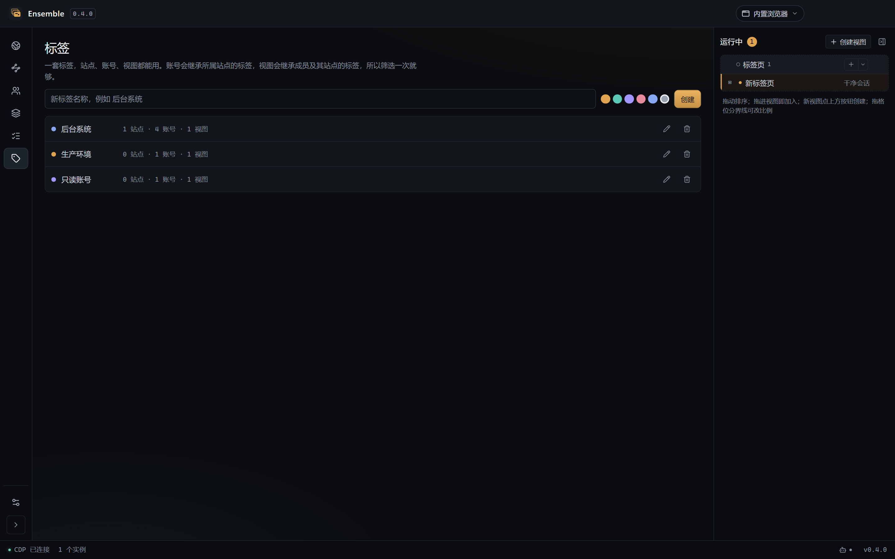

# 浏览器表面：视图与标签页

> 状态：已实施（0.5 开发版）。数据模型见
> [ADR 0007](../architecture/adr/0007-site-and-view-model.md)（站点与视图改名、账号引用）与
> [ADR 0008](../architecture/adr/0008-sites-as-login-recipes.md)（站点降级为登录配方、标签升为全局）。
>
> 实现落点：`src/main/embedded/browser.ts`（视图容器与几何）、
> `src/shared/embedded.ts`（纯规则：点击、格位、拖拽）、
> `src/renderer/src/components/BrowserPage.vue`（舞台）、
> `src/renderer/src/components/RunDock.vue`（右侧运行栏）。

## 术语

| 词 | 含义 |
| --- | --- |
| 浏览器实例 | 一个隔离的浏览器（一套 cookie、一个 session 分区）。外部模式里它就是一个系统窗口。 |
| 页面 | 实例里的一个网页，等同于浏览器里的一张标签页。 |
| 视图 | 一块共享的屏幕区域。视图里的每个格位放一个**实例**，同一时刻只显示其中几个。 |
| 格位 | 视图里的一块矩形，最多放一个浏览器实例。 |
| 台上 / 台下 | 实例是否占着格位。台上显示在屏幕上；台下仍在运行但不可见。 |
| 选中 | 「替换」操作的目标页面，同一时刻只有一个，格位头上有「选中」标记。 |

用「选中」而不是「聚焦」：焦点是浏览器的概念，点一下地址栏或应用其它控件，页面就失焦了——
四个窗口都没点时谈不上「全部失焦」。这里要表达的是**上一次操作的是哪一格**，以及下一次
「换进来」会落在哪一格，所以它读作选中。点击页面内部同样会选中该格，跟点格位头等价。

**格位放的是实例，不是页面。** 这是模型里最容易搞错的一点：页面里的链接如果以新标签页
打开（`target="_blank"`、OAuth 弹窗），新页面属于同一个实例，只是让那个实例换了一页显示，
不会多占一个格位。外部模式同理——四宫格里每一格都是一个自带标签页管理的浏览器窗口。

运行栏按实例列行：一行一个实例，下面的缩进行是它的其他页面；右上角数字是实例数，不是页面数。

「视图」在界面上只指浏览器这块区域。导航里的页面一律叫「页面」（站点页、账号页、视图页），
不叫视图。

## 默认状态

启动 → 浏览器页，左侧导航折叠，一个空白页面，光标在地址栏。

这个空白页是**主进程在启动时主动开的**（`ensureStarterTab`），不是等用户点「+」。空舞台只
有一个按钮，而用户开浏览器最想做的事是输地址或搜索——少一次点击，也就少一次"这软件是不是坏了"
的判断。恢复上次场景时不开：恢复出来的视图已经有页面，再压一个空白页会把真正的工作挡在后面。

空白页面的地址栏是**空的**，不显示 `about:blank`：新页面没有地址，让用户先删掉一段文本
才能输入是纯粹的摩擦。

此时没有任何视图，页面条是一行扁平实例，行为与普通浏览器一致。视图是可选结构，不是使用前提。

## 创建视图

视图**只能手动创建**：右侧运行栏标题栏的「创建视图」按钮。点一下得到一块空视图，
默认 2×1、名字是「新视图」（重名自动加序号），双击或右键名字改名。

不自动创建是有意为之：

- 空视图不会自动回收。刚建好的空视图就是要让人把页面放进去，回收掉就没法用了。
- 两个页面拖到一起不会「顺便」组成视图。拖拽只做两件事：在列表里排序、加入已有视图。
  想要视图就点按钮，结果可预期，不会因为一次落点偏差多出一块区域。

新建的视图可以：

- 重命名（双击或右键）、改颜色；
- 切换布局（无布局 = 单页，2×1、1×2、2×2、3×1，以及自定义预设）；
- 拖动格位分界线调整比例（见下）；
- 用组头的 ＋ 往里加页面，或把已有页面拖进来，直到格位用完；
- 点空格位里的「在这里添加标签页」：新页面直接落在该格并选中，地址栏已经可以输入；
- 把某个页面拖到指定格位（右侧运行栏的行可以直接拖到格位头上，见「拖到格位」）；
- 把页面拖出视图（拖到「标签页」块或行间），容器保留，可以随时再放回来。

拖拽的可视反馈：行上、下 28% 是高亮细线（排序），行中段是整行高亮（加入该行所在的视图），
视图块整块高亮（加入这个视图），格位头高亮（替换这一格）。

对话框里的下拉是另一个坑，和这里同源但表现相反：面板 teleport 到 `<body>`，Reka 的对话框
把「指针落在内容元素外」当成点击遮罩，于是选任何一项都会把整个对话框关掉、表单全丢。
现在浮层面板都带 `data-floating-panel`，对话框的 `pointerDownOutside` 见到这个标记就
`preventDefault()`——「面板属于对话框」这条关系由标记传递，而不是靠每个面板各自去猜。

### 拖到格位

「先选格位、再点运行栏里的页面」是文档里的路径，但几乎没人会先想到它。更顺手的是直接把
运行栏的行拖到舞台上的格位：拖到哪个格位就替换哪一格，被换下的实例退到台下。已占用的格位
拖到它的格位头，空格位拖到整格虚线框都可以。

原生页面会吃掉拖拽事件，所以拖动期间整个舞台先冻结成一张截图（`store.draggingTabId` 触发），
截图之上再铺一层透明覆盖，格位头与空格位都成了真实的落点。放下后先清掉冻结再发 IPC，
让重排落在已经恢复的舞台上。

## 三种状态

| 状态 | 含义 | 视觉 |
| --- | --- | --- |
| 台下 | 实例在视图里，没有格位 | 变暗，无格位号 |
| 台上 | 有格位，正在屏幕上 | 正常亮度，显示格位号 |
| 选中 | 替换操作的目标页面 | 左侧强调色条 + 抬升的背景 |

台上可以有多个，选中只有一个。视图里四个实例同时上屏时，只有一个是选中——
其余三个仍是台上。格位号把「哪几个在屏幕上」变成可读的事实，不需要数。

选中不再写成文字。曾经格位头右侧挂一个「选中」，占掉整条带子最金贵的宽度，而它说的正是
「这一格有强调色条」这件事：同一信息说两遍，还把页面标签挤短。现在选中态只由结构表达——
左侧强调色条加一层抬升的底色，与运行栏里选中行的画法一致。区别只在「着色强度」：强调色
只做 2px 竖条和一条 1px 顶线，不整块染色，否则四宫格里同时两格选中看起来像告警。

### 格位头里的实例标签页

一个格位放一个实例，实例自己可以有多个页面。这些页面**不占新格位**，切换它们的入口就在
格位头中间：格位号之后、贴右侧的「+」之前，就是这一格实例的页面标签。

- **一个页面也显示标签条**。它不是「可切换项列表」，而是这一格的身份说明：有标签条就说明
  「这一格是一个带标签页的浏览器」，而不是一张名字写在标题栏里的单页。同时它是唯一能放
  实例级「+」的地方。曾经只在两页以上时出现，结果单页格位看起来像只读画面。
- 未选中的标签有自己的表面（比底色略深的凹陷胶囊），当前页是抬升的浅底加强调色描边。
  早年未选中项只有一行透明文字，整条带子和格位身份混在一起，分不出「标题」和「标签」。
- **关闭按钮**：每个标签页尾部一个小 `×`，悬停或当前页时可见。关掉实例的最后一页只清空格位，
  容器本身保留（它可能是故意留空、等下一个页面的）。
- **实例级「+」**：在同一个实例里再开一个空白页。它绝不新建实例——新建实例等于第二份
  cookie 与登录态，而「一个账号同时开着控制台、接口文档和待测页面」要求它们共享会话。
- **右键菜单**：复制标签页（同一实例、同一地址）、复制地址、关闭标签页、关闭其他标签页。
  菜单是 HTML，所以要先冻结舞台；菜单项按当前实例的页面数禁用。
- **自绘提示卡**：标签只显示标题，标题还会被截断。悬停时在格位头内弹出一张小卡，带完整标题
  和地址主机名——地址是标签页里永远看不到的信息，这也是它不会和「另一个标签」混淆的原因。
  提示卡画在带子内：格位下方的区域由原生页面绘制，任何溢出都会被盖住。原生 `title` 提示
  在这里不能用：慢、无主题、部分平台还会跑到窗口外面。
  - **提示卡属于悬停的那一格**。它一度是整页共享的一个值，于是每个格位头都渲染了一张——
    鼠标放在第一格，两个窗口同时冒出同一段文字。状态里必须带格位号，模板按格位号判断。
  - **「+」不配提示**。标签条里的加号不需要解释：位置和图标已经说清它是「再加一页」，
    再挂一条文字只是多一层噪音，而且原生 `title` 会变成第二个提示系统。悬停到「+」上时
    还要把上一张标签卡清掉，否则卡片会留在原地，看起来像挂在了加号上。
- 标签名用页面标题，超长省略；页面多到放不下时标签条自己横向滚动，格位头高度恒为 26px。
- 标签前有站点图标，标签名被截断时它是唯一还认得出站点的东西。图标由主进程用该页所在会话
  下载后内联成 `data:` URL：渲染进程的 CSP 只允许 `data:` 图片，而"让渲染进程去拉远程图标"
  会多一条页面自己都没发过的请求，还会把登录态的差异扯进来。类型与大小规则在
  `inlineFavicon` 里做（非 `image/*` 一律拒绝，超过 512KB 视为配错的错误页），单测覆盖。
  图标属于来源不属于标签：跨来源导航时清掉旧的，否则新站点会顶着上一个站点的标记直到新图标到达。
- 运行栏里实例下的缩进页仍然保留：那里是跨视图的总览，格位头这里只服务当前这一格。
- 关掉实例的**根页面**时，格位必须改指向活下来的最早一页。格位用根页面 id 指代实例，
  根页面一没，格位表就指向了一个不存在的 id，下一次解析布局会把整格内容丢掉——页面还在跑，
  只是从舞台上消失了。

格位头只放编号、色点、加载状态、账号名、实例的页面标签和「+」。**格位本身**不写页面名字：
地址栏已经显示当前地址，四个格位各写一遍名字只会挤掉真正需要的信息。但标签条上的每一项
正是页面名——它不是重复格位身份，而是这个实例有哪几页可切。空格的格位没有格位头——一整格
虚线框，编号和添加按钮都放在框内居中，不会在顶部贴出一条孤零零的标签。

### 空白页

空白页（`about:blank`）的主进程原生视图**不上屏**，格位让给应用自己画的「新标签页」：
搜索框 + 引擎选择。理由很直接——空白标签页如果只是一块白色/黑色矩形，用户点完「+」得到的
唯一反馈是「什么都没有」，会以为按钮没生效。

- 输入框同时接受地址与搜索词：显式 scheme、`localhost[:端口]`、IPv4、`[IPv6]`、带点的域名
  （可带端口与路径）都当地址处理，其余按搜索词走当前引擎。判定是纯函数
  （`shared/search.ts`），单测覆盖了两侧边界。
- 页面上**只有这一个输入框**。早先还有一句「输入网址直接打开…」的说明和框下面一排引擎切换
  标签，两样都删了：说明在重复占位符已经说过的话，而那排标签和搜索框左侧的引擎下拉是同一
  份功能。一个输入框加一个下拉，规则自明。
- 引擎：Bing（默认）/ Google / 百度 / DuckDuckGo，可添加自定义引擎（模板必须 http(s) 且含
  `%s`）。选择写在设置里，新标签页与地址栏共用同一个。Bing 作默认是因为工作网络里可达，
  不是因为搜索质量。
- 地址栏也走同一个解析：两个长得一样的输入框对回车语义不一致，是最难解释的那种不一致。
- 空白页一旦导航，主进程重新布局、原生视图接管格位，应用画的那个面随之消失。

**启动即有一个空白页。** 冷启动（没有可恢复的场景）时主进程开一个空白标签页，所以切到浏览器页
看到的就是搜索框，而不是一块等着点「+」的空舞台。恢复上次场景时不加这一页：恢复出来的视图
已经有页面，再压一个空白页会把真正的工作挡在后面。

### 首页背景

新标签页的底色是**内置预设**，不是图片文件：`shared/newtab.ts` 里存 id、`background` 值和
色板小样。原因有两个——这个面必须在任何网络请求之前就画出来，而图片要下载；以及选择本身是
一个字符串（`settings.newTabBackground`），导出/导入原样带走。

- 预设五个：极光（默认）、暮色、深夜、网格、纯色。都用 `var(--bg)` 打底，所以深浅两套主题下
  都成立，不会出现浅色主题配深色壁纸的硬边。
- 选色入口是右下角的调色板按钮，点开一排圆点。它就近放在会被它影响的那个面上，而不是塞进
  设置页——用户是在看着这个面的时候才想换。
- 未知 id 回退到默认值而不是抛错（单测覆盖）：这个值来自可能被手改或旧版本导出的工作区，
  渲染时抛异常会直接让整页空白。
- 换成真图片壁纸是后续迭代，不是这一版：那需要解决来源（本地文件/网络）、尺寸适配、
  以及"图挂了显示什么"，和现在"一个闭集预设"是两种设计。

当页面属于某个账号时，格位头在色点后**显示账号名**：四个窗口并排时，页面标题往往都是同一个
后台的名字（「控制台」「首页」），光看标题分不清谁是谁。运行栏里每个实例行也显示同样的账号名，
跟着色点，所以从舞台瞄到运行栏时不用重新认一遍。

## 空舞台

一个页面都没有时，舞台中央只有一句话、一句说明和一个「新建空白标签页」按钮。

以前这里还列出一排站点，让人直接开站点。但那和地址栏、工具栏的分叉按钮是同一份东西：
地址栏就在正上方，输入站点名就会给出建议；「新建标签页」右边的箭头展开的也是同一份站点列表。
再多一处，空状态看起来像一张菜单，用户还得先读一遍才知道点哪个。空状态该做的是把**下一步**
说清楚，不是把所有功能再列一遍。

## 布局与分栏

内置预设：无布局（单页）、2×1、1×2、2×2、3×1。**「1 × 1」并入「无布局」**——两者都是
一张页面铺满舞台，留两个名字只会让人以为它们不同。旧数据里的 `1x1` 读出来就是 `free`。

相邻格位之间有一条 8px 的分隔缝，拖动它就能改比例：

- 缝是真的缝。原生页面会盖住 HTML，画在分界线上的手柄点不到，所以每个格位的右侧/下侧
  内缩 8px，露出可以按住的空隙；贴舞台边缘的一侧不内缩，页面仍然顶到窗边。
- 拖完的比例只存在于本次运行的容器里。视图定义仍保存预设，下次启动回到预设的均分；
  换预设也会丢弃手拖的比例（预设才是新的意图）。
- 两侧都至少保留 10%，拖到头也不会把某一格挤没。

## 点击规则

| 点击对象 | 主区域 | 布局变化 |
| --- | --- | --- |
| 当前视图的台上实例 | 不变 | 只改变选中 |
| 当前视图的台下实例 | 不变 | 换进当前选中格位；被换下的退到台下 |
| 其他视图的台上实例 | 切到该视图 | 只改变选中 |
| 其他视图的台下实例 | 切到该视图 | 换进该视图的选中格位 |
| 视图头 | 切到该视图 | 不变，恢复上次的选中 |
| 格位头里的实例标签页 | 不变 | 只是这一格换一页显示，格位与选中都不动 |
| 实例里的第二个页面 | 不变 | 只是这个实例换了一页显示 |

- 点击页面内部与点击格位头等价：页面获得焦点时主进程统一把该格标成选中，
  用户不必先精确点中那条 26px 的格位头。
- 换进格位是**对合操作**：再点一次就换回来。
- 当前没有选中格位时（例如刚点过地址栏），默认第 1 格。
- 上面几条可以概括成一句：**点哪个页面，就切到它所属的视图；实例若在台下，就换进该视图的
  选中格位。**

## 边界情况

| 情况 | 行为 |
| --- | --- |
| 格位比实例多 | 空格位整格虚线，框内居中一个「在这里添加标签页」按钮 |
| 关掉选中的页面 | 守住同一个实例→同一视图→全表面；实例还有别的页面就继续显示 |
| 关掉实例的最后一个页面 | 释放格位，容器保留 |
| 视图里的实例被全部拖走 | 容器保留。只有点组头 `✕`（关闭视图）才会移除容器 |
| 切换视图 | 每个视图记住自己的布局与选中页面 |
| 在视图内拖动排序 | 格位顺序跟着顺序重排，不留下旧的钉位 |
| 从运行栏拖行到格位 | 直接替换该格；拖到已占用的格位头与拖到空格位都可以 |
| 页面自己开新标签页 | 新页面属于同一实例，格位不变，运行栏那一行多一个缩进项 |

**已实现的补充：**

- 视图容器的布局改动会写回视图定义（`onViewLayoutChange`），所以下次启动仍是同一档。
  手动建的视图没有定义，改动只在本次运行内有效。
- 关页面时优先接管同一实例的兄弟页面，舞台不会跳去不相干的组。

## 与 AI 工具的关系

AI 通过 MCP 打开页面时，新页面会进入当前在台上的视图（没有视图就留作扁平实例）；
页面自己开的弹窗属于同一实例，不会变成额外的格位候选。`set_browser_layout` 在全是扁平实例时
会先把它们组成 2×1 视图再切布局——这是 AI 侧为了调用一次就出结果的便利，界面上没有对应的
自动行为。`set_browser_layout` / `pin_browser_tab` 的 `viewId` 可省略，默认作用于台上的视图。

**AI 开页面不把应用提到前台。** `open_browser_tab` 与 `open_browser_view` 都不调
`focusPage()`：不抬窗口，也不把左侧导航切到浏览器页。界面上的每一个入口仍然抬——工具栏
「+」、账号卡、视图启动都是用户刚点了一下，想看到结果；AI 不同，它把页面当工作区，经常在
用户读文档或改设置时开页，每开一页就顶一次窗口会让端点没法用。

后台开页照样能工作：新视图在停放前先拿到窗口内的真实矩形，所以截图与 DOM 读取都不受影响；
被打开的视图仍然是「台上」的激活视图，用户切回浏览器页看到的就是那一屏。这条规则是
`openEmbeddedView` 的一个 `reveal` 参数，只有 AI 传 `false`。

## 关闭语义

| 动作 | 范围 |
| --- | --- |
| 运行栏组头 `✕` | `mode: "all"`：关掉组内全部页面 |
| 视图页「停止视图」 | `mode: "opened"`：只关 `origin: "view"` 的页面，手动/AI 加的留下 |
| 实例行 `✕` | 该实例的全部页面 |
| 缩进页 | 单个页面；实例还有别的页面就继续运行 |

组头 `✕` 与视图页「停止视图」都会移除容器——这是显式关闭。「停止视图」只关这个视图启动的
页面（页面记 `origin: "view"`），手动与 AI 新增的页面留下并退回平铺列表。
「空视图不回收」说的是拖走页面这类非显式操作，不是关闭按钮。

## 右侧栏

右侧栏是「运行中」的统一入口，跨所有页面常驻，可折叠。折叠后**不是只剩一个展开按钮**：
每个运行中的实例留一个图标，点图标直接切到那个实例，这就是垂直标签页的做法。
**一行一个浏览器实例**，不是一行一个页面；实例自带的其他页面缩进列在它下面。
格位头上的标签条是同一批页面在舞台上的入口，两者看的是同一份事实，只是作用范围不同：
运行栏跨视图总览，格位头只服务当前这一格。

```
运行中 ─────────────────────  4
▾ ● 管理员验证   2/2   [2×2]  +  ✕
  ┃ 1 ● 管理员 · 主账号           2
      文档平台
      编码约束
    2 ● 成员 · 子账号
    3 ● 访客
    4 ● 审核员
▸ ● 本地部署     1/2   [1×2]  +  ✕
○ 标签页        2          +
    登录页
    接口文档
    运行中
      Chrome 实例                 EXT
```

- **视图是块级、带色、可折叠；实例是块内的行。** 层级不同，不会混淆。
- 行尾的数字是实例里的页面数，只在超过一个时出现；点缩进项切换这个实例显示的页面。
- 每个块头用同一套列顺序：折叠箭头、色点、名称、计数、弹性空白、布局选择、`+`、`✕`。
  没有布局选择的块（「标签页」、外置实例）用等宽占位保持对齐，`+` 和 `✕` 永远在同一列。
- 布局选择是应用内下拉（不是原生 `select`），选项里没有「1 × 1」——它和「无布局」是同一件事。
  它用紧凑宽度：`n×m` 是定长短文本，按最宽的选项定宽即可，箭头紧跟文字，不靠右撑开。
- 外置实例也在这里：一行一个，带 `EXT` 角标，点击把系统窗口提到前台。
- 在账号页点启动，右侧实时多出一行——这是「连续启动能看到结果」的关键。

实现补充：

- 运行栏可整栏折叠，状态记在 `localStorage`。折叠按钮的箭头指向
  面板将要收缩的方向（展开态是「向右收起」，折叠态是「向左展开」），不靠猜。
- **折叠态是一列站点图标，不是一条空白边。** 每个运行中的实例一个 34×32 的图标按钮：有
  favicon 就画 favicon（16px，来自主进程内联的 `data:` URL），没有就画账号名首字母的方块。
  点一下切到那个实例；当前实例左侧有内嵌强调条，不在舞台上的实例图标降不透明度——它还在跑，
  只是现在没显示。身份色做成右下角 5px 的小点：同一站点的两个账号 favicon 一模一样，
  靠它区分。图标列自己滚动，底部「展开」按钮固定不动，实例再多也不会找不到出口。
  照搬 Edge 垂直标签页的理由很实际——折叠是为了把宽度还给页面，不是为了藏起「有几个窗口在跑」。
- **宽度可拖**：左边缘有一条 6px 的手柄（`col-resize`），拖拽范围 240–560px，宽度记在
  `localStorage`。拖拽期间关掉过渡，松手才落盘，避免每帧写存储带来的粘滞感。
- **展开 / 收起带动画**：宽度 180ms 过渡，内容在收起时淡出并保留在 DOM 里，看起来是一次
  连续的收缩，而不是「先清空再缩」。无头测试里窗口不合成、过渡不推进，所以 E2E 会先临时
  关掉过渡再断言最终几何。
- 工具栏与运行栏里的「新建标签」是分叉按钮：主按钮 30px 高、32px 宽，与地址栏（30px）和
  旁边图标按钮（30px）齐平；`compact` 变体用于运行栏头与空格位，保持 20px 的密度。
- **工具栏只有一个高度**：地址栏、图标按钮、缩放步进器、新建标签分叉全部 30px。
  曾经「填充」是个带线框的文字按钮、「110%」是个只在非默认时出现的胶囊，两者高度与地址栏
  差 1–2px，整排看起来像从不同工具栏拼起来的。现在填充是同尺寸的钥匙图标，缩放是常驻的
  「− 110% +」步进器（数字即复位）；默认比例时用弱色，改过之后才染强调色。
- 视图格位已满时，工具栏的「+」把新页换进选中格位——创建出来的页面必须看得见，否则按钮
  像是没反应。被换下的实例留在视图里（台下），不会被关掉。
- 视图块之间也可以直接拖：拖到某个视图块上就是「加入这个视图」；行拖到舞台格位上则是
  替换那一格。
- 底部常驻一行操作说明：拖动排序、拖进视图即加入、新视图用标题栏按钮创建。
- 折叠状态、重命名、颜色都只存在于容器里，不写回视图定义——它们是「这次怎么看」，
  不是「这个视图是什么」。
- **站点菜单（分叉的箭头）三条交互规则**，都是实测修过的：
  1. 同一个箭头再点一次必须收起。用两个 `onClickOutside`（一个盯触发区、一个盯面板）会
     互相抵消：面板 teleport 到 body，点箭头是「在面板外」，点面板是「在触发区外」。
     正确做法是一个处理器，先判断点击是否落在面板里。
  2. 点左列另一个站点只切换右列账号，不关面板。
  3. **面板只在页面让开之后才出现**。冻结舞台要截图 90–120ms（两页实测），这段时间原生页面
     仍盖在面板上，看起来就是「左半边晚一拍才出现」。`coverStage()` 返回 Promise，
     `BrowserPage` 在 `setStage(null)` 之后调 `finishCover()` 兑现它，菜单再显示，
     并配 120ms 淡入把等待变成开启动画。
  4. 不在页面上挂标签文字：账号列末尾只剩一个标签名看起来像一个空分区，标签是站点页用来
     找东西的，不是选登录时需要的。

## 页面与导航

导航：浏览器 / 站点 / 账号 / 视图 / 标签 / 流程 / 设置。

- **浏览器**：正在跑的实例、页面与格位，默认页。
- **站点**：站点列表，按标签分组，可搜索。每个站点可以「打开站点」（登录页作为新标签）。
- **账号**：全部账号，按站点分组；可按运行状态、过期状态与标签筛选。
- **视图**：全部保存的视图定义（新建、成员编辑、布局、启动、删除），可按「包含的站点」
  与「包含的标签」筛选。
- **标签**：全局标签的增删改，每个标签显示使用数。
- **流程**：按站点分组的可重跑步骤序列；左列是列表，右列是步骤详情（参数、逐步动作），
  可以直接运行、编辑、删除。运行对话框在站点有多个账号时先选身份，参数按默认值预填，
  `secret` 参数用密码输入框。
- **设置**。

左侧导航默认折叠成窄条，用底部的折叠按钮展开/收起（状态记在 `localStorage`）；
折叠时悬停每一项显示 tooltip，不会自己展开。运行中的数量做成图标上的角标，折叠状态也能看到。

**设置固定在导航底部**，不跟资源页排在一起：站点、账号、视图、流程是「你存放东西的地方」，
设置是「你改变应用的地方」，混在一列里会让每天用的入口和偶尔用的入口看起来同级。底部原来那块
「工作区」信息框（站点/账号/视图三个计数）已删除——三个计数在各自页面的标题里都有，放在最
不起眼的角落既没人读，又把设置挤到了中间。

**底栏只留三类信息**：连接状态与实例数、AI 接入入口、版本号。曾经在底栏列过引擎品牌与版本
和「127.0.0.1 · 单用户」，前者在站点页与标题栏的引擎选择器里已经能看到，后者对用户没有决策
价值——底栏只有 30px，一多就得横向滚动或截断。

**AI 接入入口**是一个带机器人图标的按钮，左边一个小圆点表示端点是否在运行：运行中显示 `AI:47821`，
关闭时只有那个不亮的圆点——状态点本身已经说清了「没开」，再补一句「未开启」只是把同一件事说两遍，
在 30px 的底栏里还占地方。点它直接跳到 设置 → AI 接入，落地就能复制地址与 Token，不用先在
左侧导航摸进设置再找 tab。状态来自主进程 `mcp:changed` 广播，改端口或关端点后底栏立刻跟着变；
MCP 状态因此放在 `workspace` store 里，设置页读同一份，避免两处各持一份、改完一边另一边还停在旧端口。

**没有全局「当前站点」。** 标题栏那个站点切换器已经删掉。它只过滤管理页，而内置浏览器能打开
任何地址、新标签也不会自动进入「当前站点」——一层只管列表的选择，用它当作用域是误导。
站点现在是「去哪里 + 怎么登录」：地址、登录路径、默认密码、标签，还有账号的归属。

新建账号时表单里就有站点下拉与「新建站点…」，默认取最近使用的站点。所以前置步骤只剩一步：
建账号（站点可以顺手创建）。视图是可选的，不建也能当普通浏览器用。

## 标签

一套全局标签，站点、账号、视图都能挂：

- **账号的标签** = 自己的标签 + 所属站点的标签。给站点打「生产」，它的账号自动落进这个筛选，
  不必逐个复制。
- **视图的标签** = 自己的标签 + 成员账号与它们所属站点的标签。所以「看看碰过生产环境的视图」
  不需要给每个视图手工再打一遍。
- 标签只用于查找与分组，不参与任何业务规则；删除标签只解除关联。
- 标签管理是**左侧导航的一页**（`tags`），不再放在设置里。这是一套全局命名空间，入口挂在
  站点页会让人以为标签属于站点，而塞进设置又让人在日常操作时找不到——标签是每天都要碰的
  东西，不是一年改一次的配置。列表里每个标签显示「站点 / 账号 / 视图」的使用数，没人用的
  标签一眼可见。
- 筛选条是**单独一行、定高、横向滚动**，不换行。标签少时它只是工具栏下的一条；标签多到
  二十几个时，工具栏和卡片的高度也不变，多出来的标签往右滚。

<p align="center">
  
</p>

## 落位规则

打开账号只有一个规则：**在默认（扁平）标签组新开一个页面**，不管台上有没有视图、这个账号
是不是已经开着。

| 入口 | 落点 |
| --- | --- |
| 账号页点一张卡片 | 默认标签组新开一页，并切到它 |
| 账号页批量启动 | 新建一个视图，把选中的账号按当前布局铺开 |
| 运行栏 / 地址栏 / 视图内的「+」 | 各自指向的地方；视图内的加页进那个视图 |
| 明确点了某个格位（拖放、空格位按钮） | 替换 / 放入那一格 |

以前账号页点卡片会「已经在运行就切过去、台上有视图就占空位」。那让一次点击变成了一次
布局操作：用户只想开一页，结果台上的视图被改了。账号页的点击不是布局指令；要让某个页面
出现在视图里，路径只有两条——把它拖进视图，或者在视图里用「+」选中账号。

批量和单点是两种意图：批量启动本来就是「一次看很多」，所以它自己建一个视图；单点只是一页。


## 管理页面如何盖住浏览器

`WebContentsView` 永远画在窗口 HTML 之上，CSS `z-index` 对它无效。所以管理页面不能
「浮」在页面上，必须让页面让位。

实测（2026-10-22，Electron 44.9.0 / Chromium 152）：

| 做法 | CDP 截图 | `capturePage` | 页面脚本 |
| --- | --- | --- | --- |
| 可见 | 成功 | 成功 | 正常 |
| `setVisible(false)` | **超时失败** | 成功 | 正常 |
| 移出窗口范围 | 成功 | 成功 | 正常 |

结论：**用「移出窗口」而不是「隐藏视图」**。页面继续正常渲染、正常截图，只是人看不见；
AI 完全无感，不需要知道自己处在哪个模式。

移出的坐标有三条约束，都是实测踩出来的：

- **必须是窗口内容区右缘之外**（`parkedViewBounds`，`x = 内容区宽度`）。负数坐标（如
  `-100000`）会让渲染器把视口算成 0×0，页面按零宽度布局；而「舞台宽度」在导航栏右侧，
  停在那里等于停在窗口内部，会直接盖住管理页面。
- **新建的视图要先有真实尺寸再停放**。第一次 `setBounds` 就在窗口外的视图会永久拿到
  0×0 视口，之后移回来也不恢复。
- **窗口 resize 后重新排**，否则停放位置会随窗口缩小重新落进可见区域。

富浮层（例如带图形预览的布局选择器）用「冻结画面」：弹出前截一张舞台的图，
`` 铺在 HTML 上，把视图移出窗口，关掉浮层后恢复。简单菜单直接用原生 `Menu.popup()`，
它画在操作系统层，永远在页面之上。

实现现状：冻结走 `freezeEmbedded()`（先截图、再移出，顺序不能反），接到所有会盖住舞台的
应用层弹窗上——确认框、站点/账号/视图编辑、布局编辑器、会话健康、更新提示、新手引导、
标题栏站点菜单。判断依据是 `App.vue` 的 `overlayOpen`：任何一处漏掉，弹窗就会画在活的页面
底下，看起来像坏了。

截图本身走 CDP `Page.captureScreenshot`（带 4 秒超时回退），不再用 `capturePage`：
Electron 44 上对 `WebContentsView` 调 `capturePage` 会抛 `UnknownVizError`，冻结会静默
变成一张空白图。

## 选择器面板

往视图里加账号时打开：

```
┌─ 添加到视图 ──────────────────────────────────┐
│ [搜索站点…]        │ [搜索账号…]               │
│ ▾ 后台系统          │  ☑ 管理员 · 主账号        │
│     本地            │  ☐ 运维 · 只读            │
│     测试            │  ☐ 审计员                │
│ ▸ 前台             │                           │
│ ▾ 未分组            │  已选 2                  │
│     沙箱            │  添加到「管理员验证」     │
└───────────────────────────────────────────────┘
```

- 左侧按标签分组的站点树，可搜索。
- 右侧是选中站点的账号，可搜索。
- 每个视图记住上次选中的站点。
- 已在视图里的账号置灰或隐藏，避免重复添加。
- 多选后一次加入；视图正打开时即时生成标签并占格位。

**这一面板尚未实现**（0.5 开发版）。当前往视图里加身份的路径是：把运行栏里的标签拖进视图块，
或「从站点打开 → 用账号打开」后拖进视图，或在视图里用「+」加页。账号页点卡片不会进视图——
那是「开一页」不是「改布局」。面板解决的是「一次挑很多跨站点账号」，属于后续便利功能。

## 从站点打开

站点就是书签。浏览器页里三个地方提供同一份站点列表：

- **工具栏新建标签的分叉**：主按钮开空白标签，箭头展开「从站点打开」（再点箭头收起，
  Esc 也收起；点左列站点切换右列账号）。
- **运行栏「标签页」块的 ＋**：同样的分叉，开出来的是扁平标签。
- **地址栏输入站点名**：名称或域名匹配站点时，下方给出去往登录页的建议。

「从站点打开」左侧列站点（可按名称/地址搜索），右侧是「干净打开」和该站点下的账号：

- **干净打开**：登录页，`persist:embedded-clean` 分区，不带任何账号的登录态。
- **用账号打开**：在默认标签组新开一页，用那个账号自己的分区，登录态已经在那里。

没有做成新标签页上的书签墙，是因为空白标签本身是一个真实的 `WebContentsView`，会盖住
HTML；要做书签墙就得让标签延迟创建视图，改动大而收益不如上面三个入口。

## 登录捕获与保存

在内置浏览器里手动登录后提示保存，类似浏览器的密码气泡，但点确认打开的是账号表单：

- **只在浏览器表面生效**，外部浏览器没有扩展，明确不做扩展形态。
- **检测**：捕获阶段监听 submit、提交按钮点击和回车；要求页面里有且仅有一个可见密码框、
  用户名与密码都非空。双密码框（注册、改密码）与非 `http(s)` 页面直接忽略；同一 origin
  加用户名的重复提交在 30 秒内只提示一次。
- **已保存的账号不再提示**：按 origin 找到站点后，先用 `hasSavedLogin` 查这个用户名在凭据库
  里有没有密码——有就静默丢弃这次捕获。否则用已保存的账号登录（或 AI 用 `fill_browser_login`
  提交）都会弹一次「保存这个登录」，用户只能选择关掉。仅有账号没有密码时仍然提示，
  那正是这个提示的用途。
- **密码不进渲染进程**：页面通过 CDP `Runtime.addBinding` 把值交给主进程，渲染层只拿到
  一次性 token、用户名与来源。提示条显示站点名与用户名；保存时表单带 `captureToken`，
  主进程在一次保存中取出密码写入加密库并销毁 token。
- **站点跟随**：按 origin 匹配已有站点；没有匹配时表单直接展开「新建站点」并预填 origin，
  不会因为站点还不存在就把密码丢掉。
- **同站点同用户名已存在**时是「更新密码」，不建第二个账号——一个登录两个身份会把会话拆开。
- token 有 10 分钟有效期，用一次即废；重复使用会报错，而不是静默存一个没有密码的账号。
- 干净会话里保存的账号登录态仍在 clean 分区；保存后账号有自己的分区，下次用它打开是全新
  会话，需要重新登录一次。
- 提示条**悬浮在窗口底部**（`position: fixed`，压在状态栏之上），不是布局里的一个元素：
  它随时可能出现，不能因为出现就把整页往上挤。应用外壳是三行 grid，多出来的普通子元素
  会变成隐式第四行——这一条踩过。

## 自动填充

账号页单开、视图启动、以及「从站点打开 → 用账号打开」，都会在页面加载后自动填入用户名与
密码。三条路径共用主进程的 `scheduleEmbeddedFill`：15 秒内每 500ms 重试，只在「页面上还
没有密码框」时继续等，其它失败原因立即停止并回报。视图启动曾经整条路径都漏了这一步，
表现是「启动视图不填充、单点账号却填充」。

## 缩放与开发者工具

**缩放分两层，不做第三层（按站点）。**

| 层 | 由谁设置 | 生效范围 |
| --- | --- | --- |
| 全局默认 | 设置 → 常规 → 默认缩放 | 所有**没被手动调过**的页面；改设置时立即生效 |
| 单页覆盖 | Ctrl 加号/减号 | 只影响当前页；Ctrl + 0 清掉覆盖，回到当前全局默认 |

- 档位沿用 Chrome 的 50 / 67 / 75 / 80 / 90 / 100 / 110 / 125 / 150 / 175 / 200：两下按键
  落在和真实浏览器相同的比例上，而不是从任意百分比漂移。全局默认可以填任意整数（50–200），
  按键时吸附到相邻档位。
- 新页面从当前全局默认开始；页面自己开的子页面沿用开它的页面的比例。
- 覆盖只活在本次运行里（`TabRecord.zoomOverride`）。标签页本身不跨重启，持久化一个已不存在
  的页面的比例没有意义；重启后所有页面回到全局默认。
- **为什么不做按站点**：站点是几个账号共用的登录配方，按站点缩放会悄悄作用到「碰巧用同一
  站点」的其它账号；而且用户真正要区分的是「这一格看表格要放大」而不是「这个域名要放大」。
  多一个维度换来的灵活度，抵不上解释它和排查「为什么这页大小不对」的成本。
- 工具栏在页面比例不同于全局默认时显示一个百分比小按钮，点它即复位；相同则不显示，
  避免常驻一个「100%」的噪声。

**开发者工具默认停靠在这一页的格位里。** Electron 的 `openDevTools({ mode: "right" })`
对 `WebContentsView` 不会真的停靠——它直接开一个独立窗口。所以这里自己托管：用
`setDevToolsWebContents` 把工具渲染进一个自建的 `WebContentsView`，再把格位横向切成
「页面 58% + 工具 42%」。四宫格里每格都能各自开着工具，互不遮挡；切布局、换页或拖动分隔缝
时面板跟着自己的格子走（`applyLayout` 末尾统一重排）。屏幕太小时点工具栏的拆出按钮，把
**同一个** DevTools 视图搬进一个 900×620 的自建窗口——切换宿主不关闭 DevTools 会话，
Console 历史因此保得住；关掉那个窗口等于关闭工具，工具栏按钮同步熄灭。

因为工具是自建视图，`isDevToolsOpened()` 会返回 `false`（会话确实活着，只是宿主换了），
所以「是否打开」以我们自己的 `tab.devtools` 记录为准。

由此带来的一个连带修正：停靠后页面变窄，`freezeEmbedded()` 必须按页面真实盒子
（`innerWidth × zoom`）报告矩形，否则任何盖住舞台的弹窗都会把页面横向拉伸到整格宽度。
截图里工具区域是黑的——原生视图不进窗口像素，这和舞台本身需要冻结截图是同一个原因。

## 应用图标

开发时进程是 `electron.exe`，任何没有显式图标的窗口（以及无父窗口的原生文件对话框）都会
显示 Electron 自己的图标。因此：

- 三个 `BrowserWindow`（主窗口、悬浮条、切换回执）都传 `icon: appIconPath()`，
  开发与打包都取同一份 `build/icon.png`。
- 文件选择 / 保存对话框统一走带主窗口作为父窗口的 `showOpenDialog`/`showSaveDialog`，
  对话框因此是模态的、继承应用图标，也不会跑到主窗口后面。
- Windows 上额外设置 `app.setAppUserModelId("io.github.onefanki.ensemble")`，
  与 `electron-builder.yml` 的 `appId` 一致，任务栏按应用而不是按 electron.exe 分组。
- `tests/app-icon.test.ts` 静态检查这三条：新增窗口漏图标、或直接调用无父窗口的
  `dialog.show*`，测试立刻失败——这类回归只会在界面上看得见，靠肉眼很难反复检查。

## 与外部表面的关系

浏览器页只管理内置表面。外置实例仍由操作系统窗口承载，在右侧栏里以 `EXT` 行出现。

**启动去哪儿由标题栏右上角的启动目标决定**，不是每个入口各自带一个按钮：

| 入口 | 启动目标 = 内置 | 启动目标 = 外置 |
| --- | --- | --- |
| 账号页「启动」 | 在默认标签组新开一页 | 打开一个真实浏览器窗口 |
| 账号页批量启动 | 新建一个视图，按当前布局铺开 | 按布局平铺真实窗口 |
| 账号页「重新登录」 | 内置表面打开该身份 | 真实窗口打开该身份 |
| 视图页「启动」 | 按视图布局进入内置表面 | 按视图布局打开真实窗口 |

两个入口**不跟随**启动目标，因为它们各自只服务于一种表面：运行栏「标签页」块的 `+` 永远
新建内置标签；运行实例悬浮条永远只列外置窗口。

默认「内置」。要拿真实浏览器复核时在右上角切一次，之后所有启动入口都跟着走，不用在四个页面
里各找一遍按钮。之前账号页与视图页各有一个「内置 / 外置」按钮对，两处口径不同还占地方，
现在收成一个全局选择。

**跨站点视图两边都支持。** 内置表面本来就一格一个 `WebContentsView`，各站点互不相干；
外置启动现在按成员各自的站点逐窗口打开，再按同一份槽位坐标摆位——槽位是屏幕坐标，
不依赖站点。批量启动（账号页多选）也跨站点：它按默认布局新建一个视图或一组窗口，
成员各用各的站点与分区。

两种表面不追求界面一致。内置是主界面，外部是保真校验（见
[ADR 0006](../architecture/adr/0006-embedded-browser-first.md)）。
